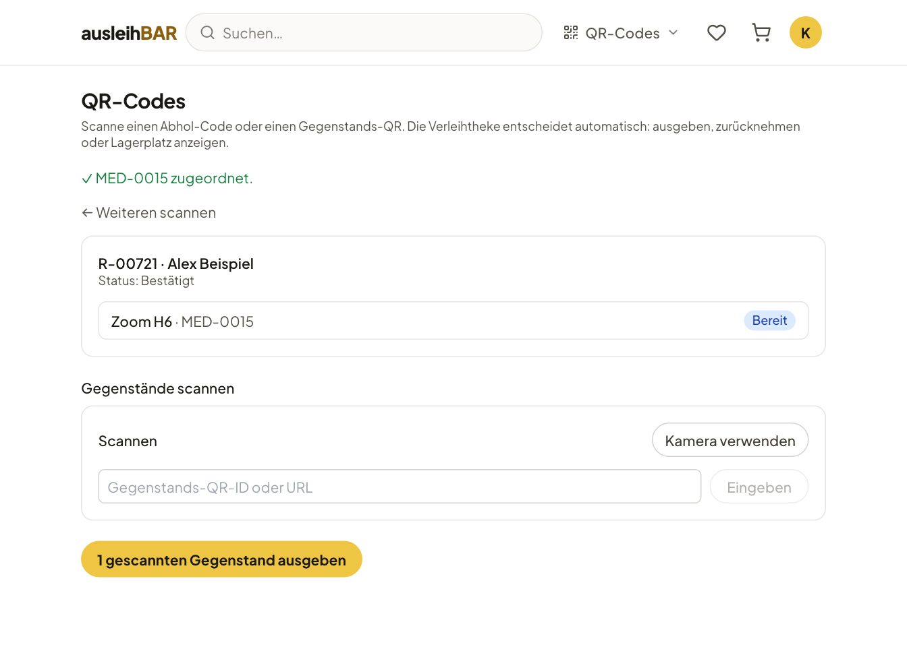

# Abholung, Rückgabe und Nutzung vor Ort

Ist deine Buchung **bestätigt**, holst du die Gegenstände an der
Verleihtheke des Pools ab. Wo die ist und wann sie geöffnet hat, steht in
der Bestätigungsmail und in [Meine Buchungen](meine-buchungen.md).

## Abholen

1. Komm am **ersten Tag** deines Zeitraums während der Öffnungszeiten zum
   Pool, bei stundenweisen Buchungen zur gebuchten Startzeit.
2. Zeig an der Theke den **Abhol-QR-Code** aus der
   [Bestätigungsmail](mails.md#bestätigungsmail), zum Beispiel auf dem
   Handy, oder nenne deine **Buchungsnummer** (z. B. R-00491).
3. Das Verleihteam scannt deinen Code und dann die QR-Etiketten der
   Gegenstände, die es dir gibt.
4. Sobald das Verleihteam die Ausgabe gebucht hat, ist sie vermerkt. In Meine Buchungen steht
   die Buchung jetzt unter **Aktuell ausgeliehen** mit dem Status
   **Abgeholt**.

So sieht das Verleihteam deine Buchung nach dem Scannen. Hat das Team
mehrere gleiche Gegenstände, kann es dir auch einen anderen als den
reservierten geben – für dich ändert sich nichts.

!!! tip "Jemand anderes holt ab?"
    Schreib das beim Absenden in die Nachricht an das Verleihteam, z. B.
    „abgeholt von Alex Beispiel“.

!!! note "Abholung verpasst"
    Hast du am ersten Tag nicht abgeholt, steht die Buchung in Meine
    Buchungen als **Abholung verpasst**, und du bekommst in der Regel eine
    Erinnerungsmail.
    Melde dich dann beim Verleihteam. Ist der ganze Zeitraum vorbei, ohne
    dass du abgeholt hast, storniert Ausleihbar die Buchung automatisch.
    Einen [Strike](strikes.md) gibt es dafür nicht automatisch; ob das
    Verleihteam einen vergibt, etwa bei wiederholtem Nichterscheinen, liegt
    in seinem Ermessen.

## Zurückgeben

1. Bring die Gegenstände **bis zum Ende deines Zeitraums** zurück zur Theke
   des Pools, bei tageweisen Buchungen spätestens am letzten gebuchten Tag
   während der Öffnungszeiten.
2. Das Verleihteam nimmt die Gegenstände zurück. Bei manchen Produkten
   hat es dafür einen Prüfhinweis, etwa welches Zubehör dazugehört, und
   schaut nach, ob alles vollständig und in Ordnung ist.
3. Ist alles zurück, steht die Buchung unter **Zurückgegeben & storniert**
   mit dem Status **Zurückgegeben**.

!!! warning "Etwas ist kaputt?"
    Sag es bei der Rückgabe. Das Verleihteam markiert den Gegenstand dann
    als defekt, damit er repariert wird und niemand anderes einen kaputten
    Gegenstand bekommt. Spätere Buchungen anderer Leute werden, wenn möglich, auf einen anderen
    Gegenstand umgebucht; sonst bekommen die Betroffenen eine Mail.

Bist du zu spät, gilt die Buchung als **überfällig**: Sie rückt in Meine
Buchungen nach oben, die Startseite zeigt einen roten Hinweis, und du
bekommst [Erinnerungen per E-Mail](mails.md#erinnerungen-bei-überfälligkeit).
Bring die Gegenstände so bald wie möglich zurück oder melde dich beim
Verleihteam. Eine deutlich verspätete Rückgabe – wie auch ein beschädigt
zurückgegebener Gegenstand – ist der typische Grund für einen
[Strike](strikes.md); ob es einen gibt, entscheidet das Verleihteam, nicht
Ausleihbar.

## Nutzung vor Ort

Manche Produkte werden nicht mitgenommen, sondern im gebuchten Zeitraum
**vor Ort genutzt**, etwa ein Podcast-Studio, ein Arbeitsplatz oder ein
3D-Drucker. Auf der Produktseite steht dann bei **Art der Nutzung**:
**Nutzung vor Ort**, und in deinen Buchungen trägt der Gegenstand die
Markierung **Vor Ort**.

Gebucht wird genau wie bei einer Ausleihe, mit Kalender, Warenkorb und
Bestätigung. Ein Warenkorb darf beides mischen. Was danach passiert, hängt
davon ab, wie der Pool das Produkt eingerichtet hat:

**Mit Ausgabe an der Theke**
:   Du meldest dich zu Beginn deines Zeitraums an der Verleihtheke. Das
    Verleihteam gibt dir den Gegenstand oder Raum frei (Status **In
    Nutzung**) und nimmt ihn am Ende zurück (Status **Genutzt**).

**Ohne Ausgabe (Selbstbedienung)**
:   Die Buchung ist nur ein reserviertes Zeitfenster. Du kommst einfach zur
    gebuchten Zeit und nutzt den Gegenstand; die Theke ist nicht beteiligt.
    Nach dem Ende schließt Ausleihbar die Buchung automatisch als
    **Genutzt** ab. Überfällig werden kann sie nicht. Stornieren kannst du
    sie nur bis zu ihrem Beginn.

!!! info "Wie erkenne ich, was gilt?"
    Die Erklärung beim Status in Meine Buchungen sagt es dir: „Melde dich zu
    Beginn deines Zeitraums an der Verleihtheke“ bedeutet Ausgabe an der
    Theke, „Du kannst die Gegenstände im gebuchten Zeitraum vor Ort nutzen“
    bedeutet Selbstbedienung.
