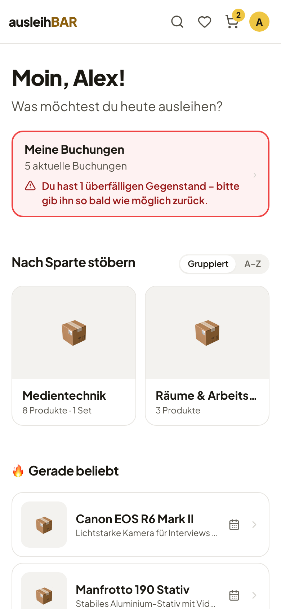
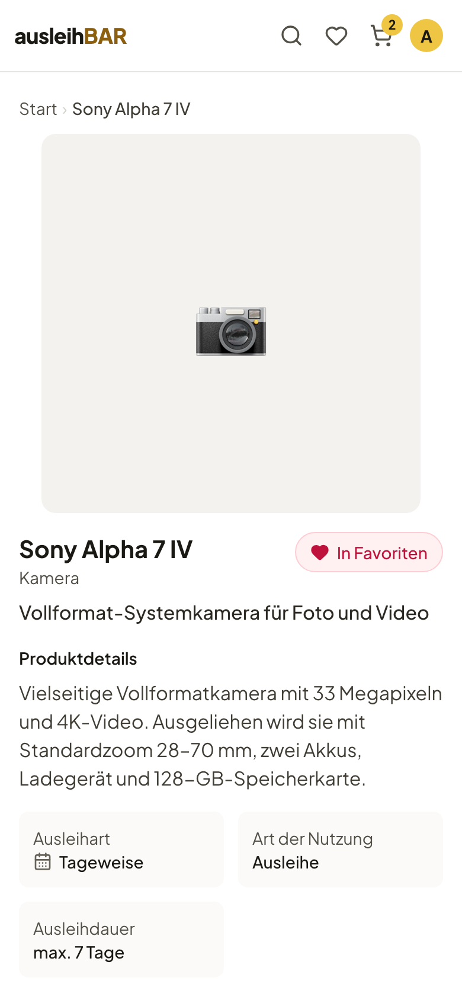

# Anmelden und Startseite

## Anmelden

Ausleihbar nutzt das **Single Sign-on** deiner Hochschule. Du brauchst also
kein eigenes Konto und kein neues Passwort, sondern meldest dich mit deiner
gewohnten Kennung an.

1. Öffne Ausleihbar im Browser, am Rechner oder auf dem Smartphone.
2. Klicke auf **Zum Starten anmelden** (oder oben rechts auf **Anmelden**).
3. Du landest auf der Anmeldeseite deiner Hochschule. Melde dich dort an.
4. Danach bist du zurück in Ausleihbar und siehst deine Startseite.

Bei der ersten Anmeldung legt Ausleihbar dein Konto automatisch an – mit
Name und E-Mail-Adresse aus der Anmeldung. An diese Adresse gehen alle
[E-Mails zu deinen Buchungen](mails.md).

!!! note "Was du ohne Anmeldung siehst"
    Ohne Anmeldung zeigt Ausleihbar nur eine Begrüßungsseite mit einem Text
    der Einrichtung und den Ausleihstellen (Pools). Klickst du auf einen
    Pool, meldest du dich an und kommst direkt zu diesem Pool. Katalog,
    Kalender und Warenkorb stehen erst nach der Anmeldung zur Verfügung.
    Auch ein Link auf ein Produkt führt dich nach der Anmeldung genau
    dorthin.

!!! info "Welche Anmeldung genau?"
    Welcher Anmeldedienst dahintersteckt, legt deine Einrichtung fest
    (Ausleihbar spricht OIDC, z. B. über Keycloak). Bei Fragen zur Kennung
    hilft dir das Rechenzentrum deiner Hochschule.

## Die Startseite

Nach der Anmeldung begrüßt dich Ausleihbar mit „Moin“ und deinem Namen.
Darunter findest du:

- **Meine Buchungen** – wie viele aktuelle Buchungen du hast. Ist etwas
  überfällig oder hast du eine Abholung verpasst, ist die Karte rot und
  sagt dir, was zu tun ist. Ein Klick öffnet [Meine Buchungen](meine-buchungen.md).
- **Nach Sparte stöbern** – die großen Bereiche des Katalogs, z. B.
  Medientechnik. Mit **Gruppiert | A–Z** schaltest du zwischen den Sparten
  und einer alphabetischen Liste aller Produkte um.
- **Gerade beliebt**, **Neu dazugekommen** und **Deine Pools** – je nach
  Einstellung deiner Einrichtung erscheinen hier Vorschläge und die
  Ausleihstellen, die du nutzen kannst.

Mehr zum Stöbern und Suchen steht unter [Gegenstände finden](finden.md).

## Die Kopfzeile

Die Kopfzeile ist immer da, auch beim Scrollen:

- Ein Klick auf **ausleihBAR** bringt dich zur Startseite.
- Das **Suchfeld** durchsucht den ganzen Katalog.
- Das **Herz** öffnet deine [Favoriten](finden.md#favoriten).
- Der **Warenkorb** zeigt mit einer Zahl, wie viele Gegenstände drinliegen.
- Hinter deinem **Initial** liegt das Kontomenü.

Beim Stöbern im Katalog steht unter der Kopfzeile außerdem **Verfügbar ab**:
Wählst du dort ein Datum, zeigen die Produktkarten, wie viele Einheiten an
diesem Tag frei sind.

## Auf dem Smartphone

Ausleihbar ist fürs Smartphone gemacht. Du brauchst keine App: Der Browser
genügt. Auf dem kleinen Bildschirm wird das Suchfeld zur Lupe, alles andere
funktioniert wie am Rechner.

## Sprache und Darstellung

Im **Kontomenü** (dein Initial oben rechts) findest du:

- **Meine Buchungen**,
- die **Sprache** der Oberfläche, Deutsch oder Englisch – deine Wahl gilt
  auch für die E-Mails, die du von Ausleihbar bekommst,
- die **Darstellung**: Hell, Dunkel oder Automatisch (folgt dem System),
- **Abmelden**.

Ganz unten auf jeder Seite verlinkt die Fußzeile Seiten wie Impressum und
Datenschutz, sofern deine Einrichtung sie angelegt hat.
