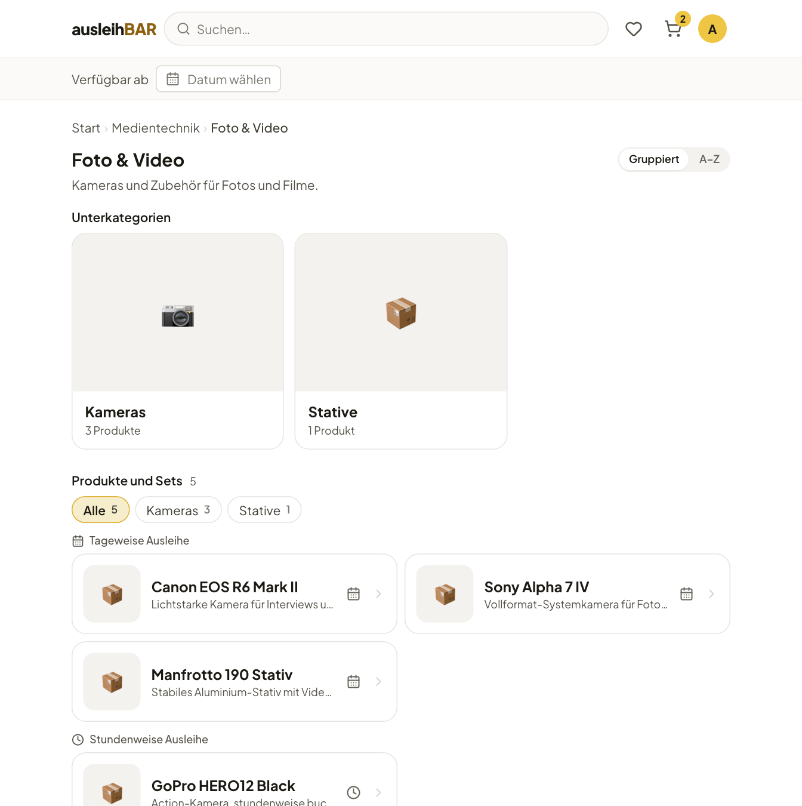
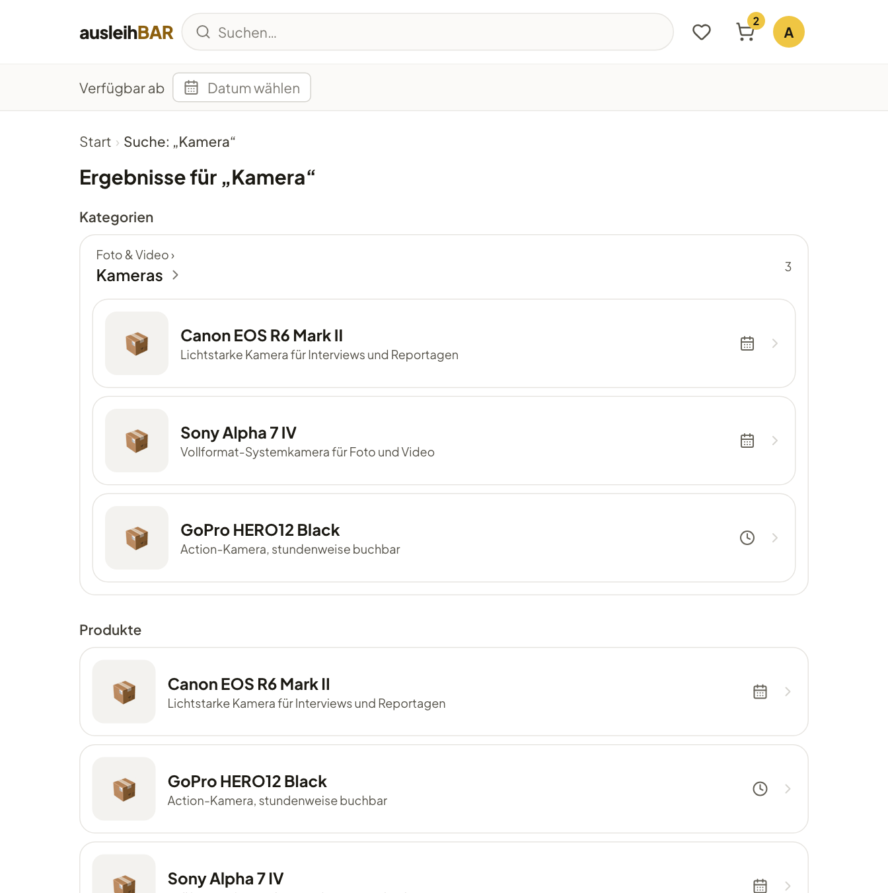

# Gegenstände finden

Der Katalog ist wie ein Onlineshop aufgebaut: Er besteht aus **Produkten**
(z. B. „Sony Alpha 7 IV“). Hinter jedem Produkt stehen ein oder mehrere
gleichwertige **Gegenstände**, also die einzelnen Kameras, die tatsächlich
im Regal liegen. Du buchst das Produkt; welcher Gegenstand es genau wird,
regelt Ausleihbar.

## Stöbern: Sparten und Kategorien

Die Startseite zeigt die **Sparten**, die großen Bereiche des Katalogs, etwa
„Medientechnik“ oder „Räume & Arbeitsplätze“. Jede Sparte gliedert sich in
**Kategorien**, Kategorien wiederum in **Unterkategorien**.

1. Klicke auf der Startseite unter **Nach Sparte stöbern** eine Sparte an.
2. Wähle eine Kategorie, z. B. „Foto & Video“.
3. Oben siehst du die **Unterkategorien**, darunter alle **Produkte und
   Sets** der Kategorie samt ihrer Unterkategorien.
4. Mit den Filterchips (**Alle**, **Kameras**, **Stative** …) grenzt du die
   Liste auf eine Unterkategorie ein.

Die Produkte stehen getrennt nach **Tageweise Ausleihe** und **Stundenweise
Ausleihe**. Auch auf jeder Produktkarte verrät ein kleines Symbol die
Ausleihart: der Kalender für tageweise, die Uhr für stundenweise.
Über den Brotkrümelpfad oben kommst du jederzeit eine Ebene zurück.

!!! tip "Alles von A bis Z"
    Mit dem Umschalter **Gruppiert | A–Z** siehst du statt der Sparten eine
    alphabetische Liste aller Produkte. Ausleihbar merkt sich deine Wahl.

## Suchen

Tippe einen Begriff in das **Suchfeld** in der Kopfzeile und drücke
++enter++. Die Suche findet:

- **Produkte**, deren Name oder Beschreibung den Begriff enthält,
- **Kategorien** und **Sparten**, deren Name passt – samt ihrem Inhalt.

!!! tip "Was ist ab einem bestimmten Tag frei?"
    Wähle unter der Kopfzeile bei **Verfügbar ab** ein Datum. Kategorie-,
    Such- und Pool-Seiten zeigen dann auf jeder Produktkarte, wie viele
    Einheiten an diesem Tag frei sind. Mit **zurücksetzen** blendest du das
    wieder aus.

## Pools: die Ausleihstellen

Ein **Pool** ist eine Ausleihstelle mit eigenem Ort, eigenen
Öffnungszeiten und eigenem Verleihteam, etwa das „Medienlabor, Raum 1.12“.
Dasselbe Produkt kann in mehreren Pools stehen.

Unter **Deine Pools** auf der Startseite (falls deine Einrichtung die Reihe
eingeschaltet hat) öffnest du die Seite eines Pools. Dort findest du
Adresse, Servicezeiten, Anfahrt und alle Produkte, die es hier gibt, und kannst
gezielt in diesem Pool suchen. Mit den Pfeilen blätterst du zum vorherigen
oder nächsten Pool.

!!! note "Nicht jeder Pool ist für alle sichtbar"
    Ein Pool kann auf bestimmte Gruppen beschränkt sein, zum Beispiel auf
    Lehrende oder auf einen Fachbereich. Die Zugehörigkeit ergibt sich aus
    einer Gruppe, in die dich die Administration aufgenommen hat, oder
    automatisch aus Angaben deiner Anmeldung. Du siehst nur die Pools und
    Produkte, die du auch buchen darfst. Fehlt dir etwas, das es geben
    sollte, frag das Verleihteam.

## Favoriten

Was du öfter brauchst, merkst du dir als Favorit:

1. Öffne die Produktseite und klicke auf **Zu Favoriten**. Der Knopf
   wechselt auf **In Favoriten**.
2. Das **Herz** in der Kopfzeile öffnet die Seite **Favoriten**.
3. Dort sind deine Favoriten nach **Tageweise Ausleihe** und
   **Stundenweise Ausleihe** getrennt. Wähle einen Zeitraum (**Von** und
   **Bis**, bei stundenweisen Produkten **Tag**, **Von** und **Bis**).
4. Ausleihbar zeigt für jeden Favoriten, ob er im Zeitraum **verfügbar**,
   **nur teilweise** verfügbar oder **nicht verfügbar** ist.
5. Hake die gewünschten Produkte an und klicke auf **Reservieren – in den
   Warenkorb**.

So legst du mehrere Gegenstände für denselben Zeitraum mit einem Klick in
den [Warenkorb](warenkorb.md). Über das ✕ neben einem Favoriten entfernst
du ihn wieder aus der Liste.
