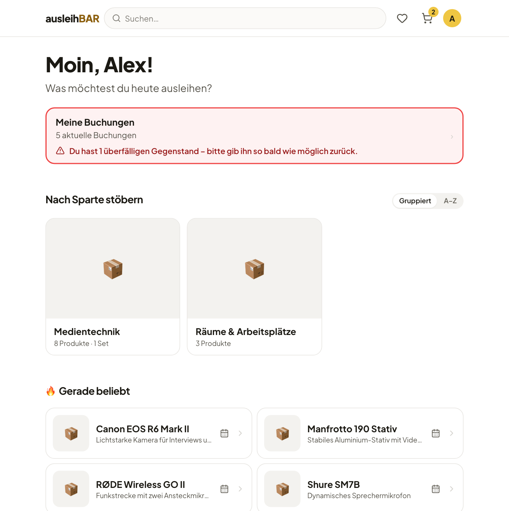

# Anleitung für Ausleihende

Ausleihbar ist der Onlineshop für alles, was deine Hochschule verleiht:
Kameras, Mikrofone, Laptops, aber auch Räume oder Arbeitsplätze, die du vor Ort
nutzt. Du suchst dir aus, was du brauchst, wählst im Kalender einen freien
Zeitraum und schickst die Buchung ab. Das Verleihteam bestätigt sie, und du
holst die Gegenstände an der Verleihtheke ab.

Diese Anleitung ist für alle, die etwas ausleihen möchten. Wenn du selbst
verleihst oder Ausleihbar verwaltest, findest du die Theke und die
Administration unter [Für Verleihende & Admins](../verwaltung/index.md).

!!! tip "Die ersten Schritte"
    1. [Melde dich an](anmelden.md) – mit deiner Hochschulkennung.
    2. [Finde einen Gegenstand](finden.md) über die Sparten oder die Suche.
    3. Wähle auf der [Produktseite](produkt.md) einen Zeitraum und lege ihn
       in den Warenkorb.
    4. [Schicke die Buchung ab](warenkorb.md) und warte auf die
       Bestätigungsmail.
    5. [Hol die Gegenstände ab](abholung.md) und bring sie pünktlich zurück.

## Kapitel

-   :material-login: **[Anmelden und Startseite](anmelden.md)**

    Single Sign-on, die Startseite, Sprache und Darstellung.

-   :material-magnify: **[Gegenstände finden](finden.md)**

    Sparten, Kategorien, Suche, Pools und Favoriten.

-   :material-calendar-month: **[Produktseite und Verfügbarkeit](produkt.md)**

    Details, Ausleihdauer und der Kalender für Tage oder Stunden.

-   :material-bag-personal-outline: **[Sets](sets.md)**

    Mehrere Produkte, die zusammen gebucht werden.

-   :material-cart-outline: **[Warenkorb und Buchung absenden](warenkorb.md)**

    Haltezeit, Nachricht an das Verleihteam, eine Buchung je Pool.

-   :material-format-list-checks: **[Meine Buchungen](meine-buchungen.md)**

    Was ansteht, was du hast, was überfällig ist – und stornieren.

-   :material-swap-horizontal: **[Abholung, Rückgabe und Nutzung vor Ort](abholung.md)**

    Was an der Verleihtheke passiert.

-   :material-email-outline: **[E-Mails und Erinnerungen](mails.md)**

    Welche Mails du bekommst und was drinsteht.

-   :material-alert-octagon-outline: **[Strikes und Sperren](strikes.md)**

    Was ein Strike ist und was eine Sperre bedeutet.

