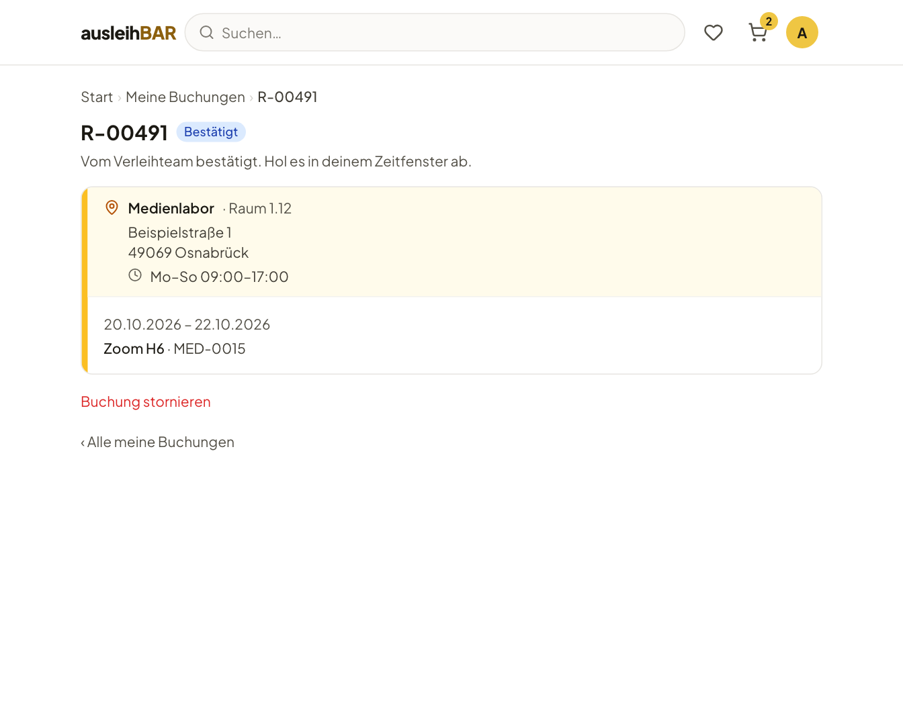

# Meine Buchungen

Unter **Meine Buchungen** siehst du alle deine Buchungen mit ihrem Stand. Du
erreichst die Seite über die Karte auf der Startseite oder über das
Kontomenü (dein Initial oben rechts).

## Die Abschnitte

- **Überfällig** – steht ganz oben, wenn es etwas gibt: Gegenstände, die du
  hättest zurückgeben müssen, oder eine verpasste Abholung. Bitte gib sie so
  bald wie möglich zurück oder melde dich beim Verleihteam.
- **Anstehend** – für dich gebucht, aber noch nicht abgeholt oder genutzt.
- **Aktuell ausgeliehen** – was du gerade hast oder nutzt und noch
  zurückgeben musst.
- **Zurückgegeben & storniert** – abgeschlossene Buchungen, nichts mehr zu
  tun.

Hast du [Strikes](strikes.md), steht oben außerdem **Deine Strikes**.

Jede Buchung steht in der Karte ihres **Pools**, mit Raum, Adresse und
Öffnungszeiten. So weißt du, wohin du zum Abholen gehst. Darunter stehen
die Buchungsnummer, der Status, ein Satz, was er für dich bedeutet, die
Gegenstände mit ihrem Zeitraum und deine Nachricht an das Verleihteam.

## Die Status

| Status | Was er bedeutet |
| --- | --- |
| **Noch nicht bestätigt – noch nicht gültig** | Du hast die Buchung abgeschickt, das Verleihteam muss sie noch bestätigen. Abholen kannst du noch nicht. |
| **Bestätigt** | Vom Verleihteam bestätigt. Hol die Gegenstände in deinem Zeitraum ab. |
| **Abgeholt** | Du hast die Gegenstände. Gib sie bis zum Ende des Zeitraums zurück. |
| **Zurückgegeben** | Alles zurück, alles erledigt. |
| **Storniert** | Die Buchung wurde storniert. |

Bei der [Nutzung vor Ort](abholung.md#nutzung-vor-ort) heißen zwei Status
anders: **In Nutzung** statt Abgeholt und **Genutzt** statt Zurückgegeben.
Auch die Erklärungen sprechen dann von Nutzen statt Abholen.

Zusätzlich können rote Hinweise erscheinen:

- **Überfällig seit …** – die Rückgabe ist überfällig.
- **Abholung verpasst (…)** – du hast die Gegenstände nicht abgeholt. Melde
  dich beim Verleihteam.
- **Strike erhalten** – zu dieser Buchung hat das Verleihteam einen Strike
  vergeben; der Grund steht in der Karte.

## Eine Buchung im Detail

Ein Klick auf die **Buchungsnummer** (z. B. R-00491) öffnet die
Detailseite mit Status, Pool, Zeitraum und den Gegenständen samt
Inventarnummer.

!!! info "QR-Code und Kalendereintrag"
    Den **Abhol-QR-Code** und den **Kalendereintrag** (`.ics`) findest du
    nicht auf dieser Seite, sondern als Anhänge der
    [Bestätigungsmail](mails.md#bestätigungsmail). Der QR-Code führt beim
    Scannen genau auf diese Detailseite.

## Stornieren

Kommt etwas dazwischen, storniere die Buchung, damit andere die
Gegenstände nutzen können:

- Klicke in Meine Buchungen auf das **Papierkorb-Symbol** der Buchung, oder
- klicke auf ihrer Detailseite auf **Buchung stornieren**.

Eine Rückfrage zeigt dir, welche Buchung du stornierst. Bestätige mit
**Buchung stornieren** oder behalte sie mit **Buchung behalten**.

!!! warning "Nicht rückgängig zu machen"
    Eine stornierte Buchung lässt sich nicht wiederherstellen. Die
    Gegenstände sind dann wieder für andere frei. Brauchst du sie doch,
    buche neu.

Stornieren kannst du, solange die Buchung **noch nicht bestätigt** oder
**bestätigt** ist und noch nichts davon abgeholt wurde. Eine
[Nutzung vor Ort ohne Ausgabe](abholung.md#nutzung-vor-ort) kannst du nur
bis zu ihrem Beginn stornieren. Danach ist das Symbol verschwunden. Wenn du
später nicht kommen kannst, gib dem Verleihteam Bescheid.

!!! tip "Lieber stornieren als nicht kommen"
    Eine Buchung, die nie abgeholt wird, blockiert den Gegenstand für
    andere. Einen [Strike](strikes.md) gibt es dafür nicht automatisch –
    das entscheidet das Verleihteam.
