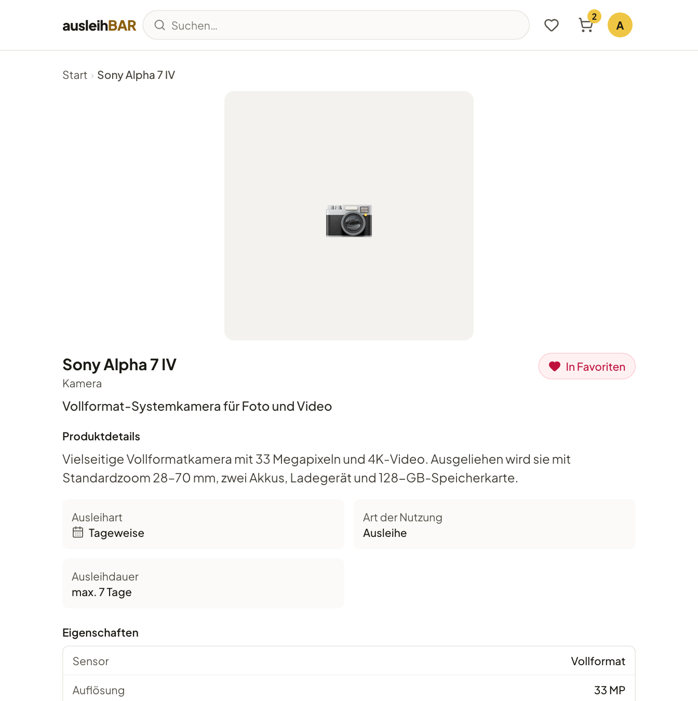
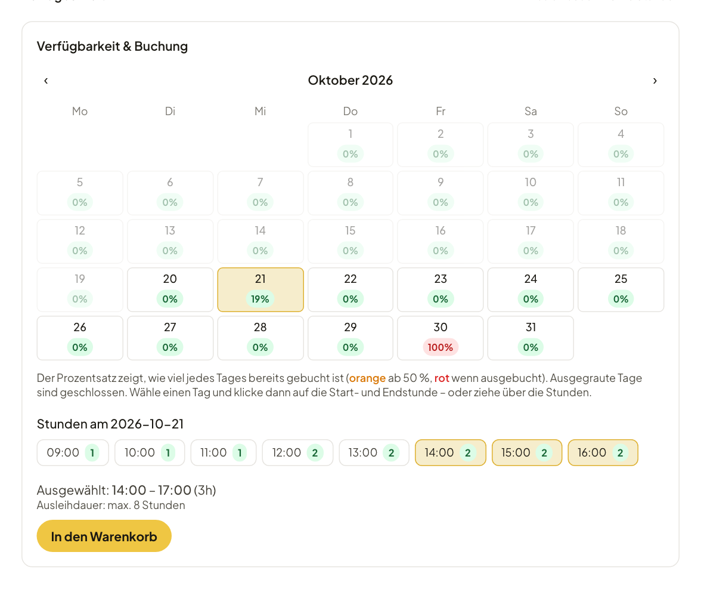

# Produktseite und Verfügbarkeit

Auf der Produktseite findest du alles, was du vor dem Buchen wissen musst,
und darunter den Kalender, in dem du deinen Zeitraum wählst.

## Was die Produktseite zeigt

- **Bilder** — mehrere Bilder lassen sich durchblättern und vergrößern.
- **Zu Favoriten** — merkt das Produkt für deine [Favoriten](finden.md#favoriten).
- **Produktdetails** — die Beschreibung, oft mit dem Zubehör, das dazugehört.
- **Ausleihart** — **Tageweise** oder **Stundenweise**.
- **Art der Nutzung** — **Ausleihe** (du nimmst den Gegenstand mit) oder
  **Nutzung vor Ort** (du nutzt ihn im gebuchten Zeitraum an Ort und Stelle,
  z. B. einen Raum oder einen 3D-Drucker; siehe
  [Nutzung vor Ort](abholung.md#nutzung-vor-ort)).
- **Ausleihdauer** — die kürzeste und längste erlaubte Dauer, falls es eine
  gibt.
- **Eigenschaften** — technische Angaben wie Sensor oder Auflösung, je nach
  Produkttyp, manchmal auch ein Datenblatt als PDF.
- **Verfügbar bei** — die Pools, in denen das Produkt steht, mit Adresse.
  Verlangt ein Pool eine Vorlaufzeit, steht dort z. B. „mind. 24 h im Voraus
  buchen“.
- **Teil von Sets** — [Sets](sets.md), in denen das Produkt enthalten ist.
- **Ergänzende Gegenstände** — Produkte, die das Verleihteam als passende
  Ergänzung empfiehlt, etwa ein Stativ zur Kamera, jeweils mit den Pools, in
  denen es sie gibt.

## Tageweise buchen

Ganz unten steht der Kalender **Verfügbarkeit & Buchung**.

1. Die Zahl in jedem Tag sagt, wie viele Einheiten an diesem Tag frei sind
   (grün = frei, rot = keine mehr übrig).
2. Klicke auf deinen ersten Tag und dann auf deinen letzten Tag. Du kannst
   auch vom Start- zum Endtag ziehen. Ein einzelner Klick bucht einen Tag.
3. Unter dem Kalender steht der gewählte Zeitraum, z. B. „Ausgewählt:
   23.10.2026 → 25.10.2026“. Mit **Auswahl aufheben** fängst du neu an.
4. Steht das Produkt in mehreren Pools, wählst du danach den **Abholort**.
   Ausleihbar zeigt, welcher Pool im gewählten Zeitraum noch etwas frei hat,
   und schlägt einen Pool vor, der schon in deinem Warenkorb liegt.
5. Klicke auf **In den Warenkorb**.

Der erste Tag ist dein Abholtag, der letzte dein Rückgabetag.

!!! note "Geschlossene Tage"
    Tage mit Schloss sind **geschlossen**: Feiertage, Sperrtage oder
    Wochentage, an denen der Pool nicht öffnet. Auch Tage jenseits des
    Buchungshorizonts erscheinen so. Geschlossene Tage können weder Abhol-
    noch Rückgabetag sein, eine Buchung darf sich aber über sie erstrecken —
    etwa von Freitag bis Montag über ein geschlossenes Wochenende.

!!! tip "Ausleihdauer"
    Ist der Zeitraum zu kurz oder zu lang, sagt dir der Kalender, was
    erlaubt ist („Du kannst maximal 7 Tage am Stück buchen.“). Die Grenzen
    kommen vom Produkt oder vom Pool und können sogar je Gegenstand
    abweichen. Wie weit im Voraus du höchstens buchen kannst und ob es eine
    Vorlaufzeit gibt, legt der Pool fest.

## Stundenweise buchen

Bei stundenweisen Produkten zeigt jeder Tag, **wie viel Prozent** des Tages
schon gebucht sind (orange ab 50 %, rot wenn ausgebucht).

1. Klicke auf einen Tag. Darunter erscheinen die Stunden des Tages mit der
   Zahl freier Einheiten, so weit der Pool geöffnet hat.
2. Klicke auf die Startstunde und dann auf die Endstunde, oder ziehe über
   die Stunden.
3. Prüfe die Angabe „Ausgewählt“, z. B. „14:00 – 17:00 (3h)“.
4. Wähle, falls nötig, den **Abholort** und klicke auf **In den Warenkorb**.

## Nach dem Klick

Das Produkt liegt jetzt im Warenkorb, und ein Gegenstand ist für dich
**reserviert**. Du kannst weiter stöbern und mehr hinzufügen oder über
**Zum Warenkorb** direkt weitermachen — siehe
[Warenkorb und Buchung absenden](warenkorb.md).

!!! warning "Konto gesperrt?"
    Ist dein Konto gesperrt, bleibt **In den Warenkorb** ausgegraut. Was das
    bedeutet, steht unter [Strikes und Sperren](strikes.md).
