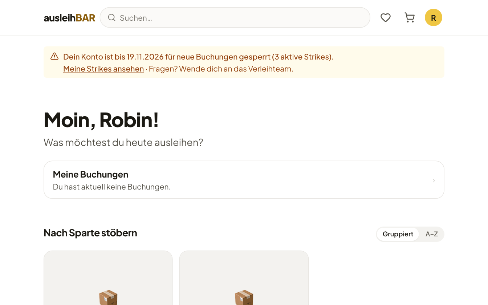

# Strikes und Sperren

Damit Gegenstände für alle verfügbar bleiben, kann das Verleihteam
**Strikes** vergeben, wenn bei einer Buchung etwas schiefgeht. Typische
Gründe sind eine **deutlich verspätete Rückgabe** oder ein Gegenstand, der
**beschädigt oder verschmutzt** zurückkommt; eine einzelne verpasste Abholung
ist meist kein Grund, wiederholtes Nichterscheinen kann einer sein. Wer zu
viele Strikes sammelt, wird für eine Zeit für neue Buchungen gesperrt.

!!! note "Nie automatisch"
    Ausleihbar vergibt **keine Strikes von selbst** – weder bei einer
    verpassten Abholung noch bei einer überfälligen Rückgabe. Ob ein Strike
    angemessen ist, entscheidet immer eine Person im Verleihteam und gibt
    dabei einen Grund an. Automatisch ist nur die **Sperre**, sobald die von
    deiner Einrichtung festgelegte Zahl aktiver Strikes erreicht ist.

## Was ist ein Strike?

- Ein Strike gehört in der Regel zu einer **Buchung** und hat immer einen
  **Grund**, den das Verleihteam angibt.
- Strikes zählen **über alle Pools** hinweg, egal welches Verleihteam sie
  vergeben hat.
- Jeder Strike **verfällt** nach einer festen Zeit, die deine Einrichtung
  einstellt. Abgelaufene Strikes zählen nicht mehr.
- Löschen kann einen Strike nur die Administration.

Bekommst du einen Strike, schickt Ausleihbar dir die Mail **„Strike zu
deiner Buchung R-…“** mit dem Grund, einer eventuellen persönlichen
Nachricht des Verleihteams, dem Ablaufdatum und der Zahl deiner aktiven
Strikes. Sie sagt dir auch, ab wie vielen Strikes eine Sperre folgt – oder
dass dein Konto jetzt gesperrt ist.

In [Meine Buchungen](meine-buchungen.md) trägt die betroffene Buchung den
Hinweis **Strike erhalten** samt Grund.

## Wann wird ein Konto gesperrt?

Deine Einrichtung legt Stufen fest, zum Beispiel: ab einer bestimmten Zahl
aktiver Strikes eine Sperre für einige Tage, bei mehr Strikes eine längere
oder eine dauerhafte Sperre. Erreichst du eine Stufe, sperrt Ausleihbar
dein Konto automatisch für die festgelegte Zeit – das ist der einzige
automatische Schritt; die Strikes selbst vergibt immer das Verleihteam.

## Der Hinweis auf der Seite

Ist dein Konto gesperrt, steht oben auf der Startseite, auf Produkt- und
Set-Seiten, in den Favoriten, im Warenkorb und in Meine Buchungen ein
Hinweis, zum Beispiel:
„Dein Konto ist bis 19.11.2026 für neue Buchungen gesperrt (3 aktive
Strikes).“

Solange die Sperre gilt:

- kannst du **nichts in den Warenkorb legen** – der Knopf **In den
  Warenkorb** bleibt ausgegraut,
- kannst du **keine Buchung abschicken**,
- kannst du weiter stöbern und deine Buchungen ansehen.

Bei einer zeitlich begrenzten Sperre kannst du nach dem genannten Datum
wieder buchen. Bei einer dauerhaften Sperre heißt es „Dein Konto ist
dauerhaft für neue Buchungen gesperrt …“.

## Deine Strikes ansehen

Klicke im Hinweis auf **Meine Strikes ansehen**. Du landest in Meine
Buchungen im Abschnitt **Deine Strikes**. Dort steht zu jedem Strike:

- das Datum,
- der Grund,
- die Buchung und der Pool,
- wann er abläuft („Läuft ab am …“) – oder **Abgelaufen**, wenn er nicht
  mehr zählt.

!!! tip "Fragen? Sprich mit dem Verleihteam"
    Hältst du einen Strike für falsch oder gibt es einen Grund für die
    Verspätung, wende dich an das Verleihteam des Pools. Die Kontaktdaten
    stehen in der Strike-Mail und in deinen Buchungsmails. Die Administration
    kann einen Strike löschen oder eine Sperre aufheben.
