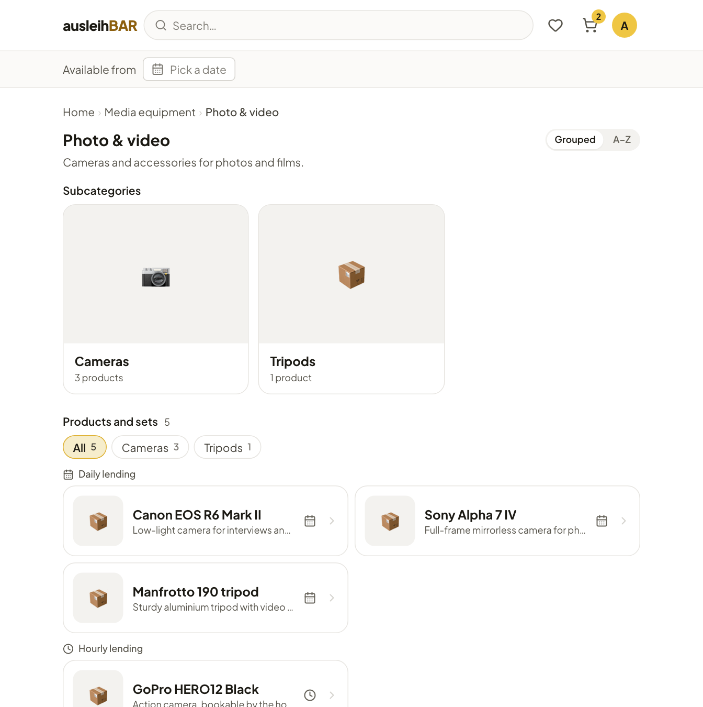
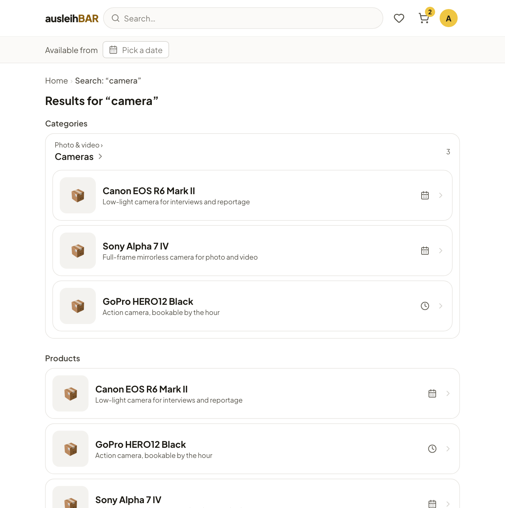

# Finding items

The catalog is organized like an online shop: it consists of **products**
(e.g. “Sony Alpha 7 IV”). Behind each product are one or more equivalent
**items** – the individual cameras that actually sit on the shelf. You book
the product; Ausleihbar decides which item exactly you get.

## Browsing: sections and categories

The start page shows the **sections**, the main areas of the catalog, such
as “Media equipment” or “Rooms & workspaces”. Each section is divided into
**categories**, and categories in turn into **subcategories**.

1. On the start page, click a section under **Browse by section**.
2. Choose a category, e.g. “Photo & video”.
3. At the top you see the **Subcategories**, below them all **Products and
   sets** of the category including its subcategories.
4. With the filter chips (**All**, **Cameras**, **Tripods** …) you narrow
   the list down to one subcategory.

The products are listed separately under **Daily lending** and **Hourly
lending**. A small icon on each product card also shows the lending type:
the calendar for daily, the clock for hourly.
The breadcrumb at the top always takes you back one level.

!!! tip "Everything from A to Z"
    With the **Grouped | A–Z** switch you see an alphabetical list of all
    products instead of the sections. Ausleihbar remembers your choice.

## Searching

Type a term into the **search field** in the header and press
++enter++. The search finds:

- **products** whose name or description contains the term,
- **categories** and **sections** whose name matches – including their
  contents.

!!! tip "What is free from a certain day?"
    Pick a date at **Available from** below the header. Category, search and
    pool pages then show on every product card how many units are free on
    that day. Click **clear** to hide it again.

## Pools: the lending locations

A **pool** is a lending location with its own place, its own opening hours
and its own lending team, such as the “Media Lab, Room 1.12”. The same
product can be in several pools.

Under **Your pools** on the start page (if your institution has turned
that row on), you open a pool's page. There you will find the address,
service hours, directions and all products available there, and you can
search within this pool. The arrows take you to the previous or next pool.

!!! note "Not every pool is visible to everyone"
    A pool can be restricted to certain groups, for example to teaching
    staff or to one department. Membership comes from a group that the
    administration or the lending team has added you to, or
    automatically from details in your sign-in. You only see the pools and
    products you are allowed to book. If something you expect is missing,
    ask the lending team – they can add you to their pool's
    [access group](../management/access-groups.md).

## Favorites

Things you need often can be saved as favorites:

1. Open the product page and click **Add to favorites**. The button
   changes to **In favorites**.
2. The **heart** in the header opens the **Favorites** page.
3. There your favorites are split into **Daily rental** and **Hourly
   rental**. Choose a period for each list: for daily products the first
   and last day (**From** and **Until**), for hourly ones the **Day** plus the
   times **From** and **Until**.
4. For each favorite, Ausleihbar shows whether it is **available**, **only
   partly** available or **unavailable** in that period.
5. Tick the products you want and click **Reserve — add to cart**.

This way you put several items for the same period into the
[cart](cart.md) with a single click. The ✕ next to a favorite removes it
from the list again.
