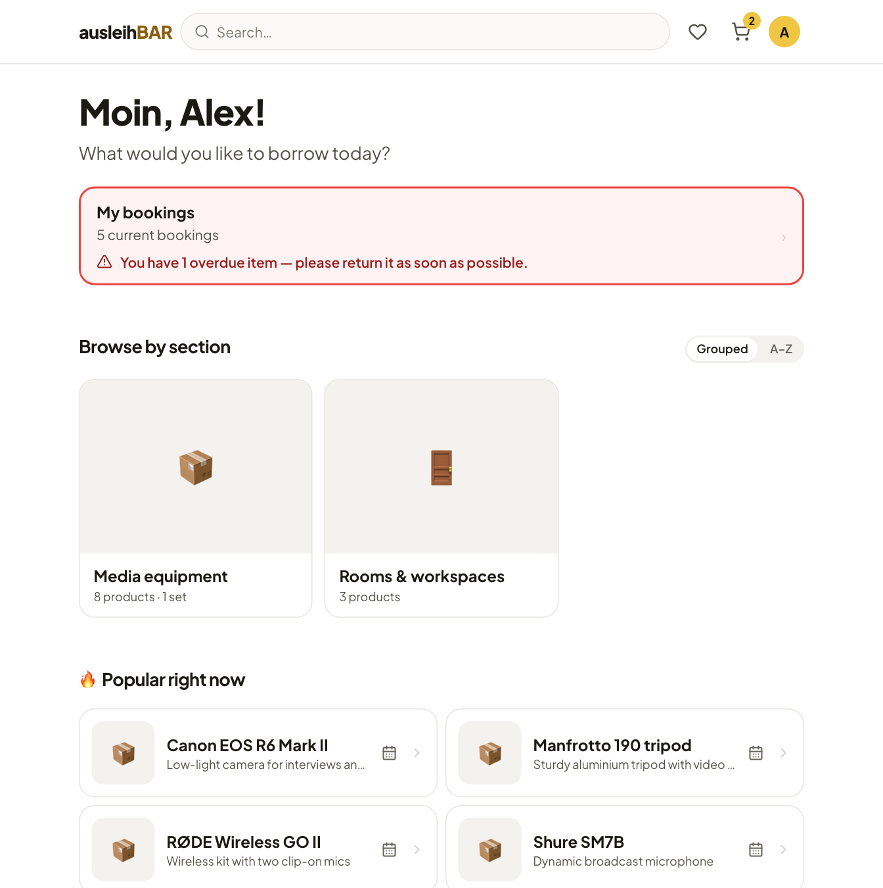

# Guide for borrowers

Ausleihbar is the online shop for everything your university lends out:
cameras, microphones, laptops, but also rooms or workspaces that you use on
site. You pick what you need, choose a free period in the calendar and
submit the booking. The lending team confirms it, and you pick up the items
at the lending desk.

This guide is for everyone who wants to borrow something. If you lend items
yourself or manage Ausleihbar, you will find the lending desk and the
administration under [For lenders & admins](../management/index.md).

!!! tip "Getting started"
    1. [Sign in](sign-in.md) with your university account.
    2. [Find an item](finding-items.md) through the sections or the search.
    3. Choose a period on the [product page](product-page.md) and add it to
       the cart.
    4. [Submit the booking](cart.md) and wait for the confirmation email.
    5. [Pick up the items](pickup-and-return.md) and bring them back on
       time.

## Chapters

-   :material-login: **[Signing in and the start page](sign-in.md)**

    Single sign-on, the start page, language and appearance.

-   :material-magnify: **[Finding items](finding-items.md)**

    Sections, categories, search, pools and favorites.

-   :material-calendar-month: **[Product page and availability](product-page.md)**

    Details, lending duration and the calendar for days or hours.

-   :material-bag-personal-outline: **[Sets](sets.md)**

    Several products that are booked together.

-   :material-cart-outline: **[Cart and submitting a booking](cart.md)**

    Hold time, message to the lending team, one booking per pool.

-   :material-format-list-checks: **[My bookings](my-bookings.md)**

    What's coming up, what you have, what's overdue – and cancelling.

-   :material-swap-horizontal: **[Pickup, return and on-site use](pickup-and-return.md)**

    What happens at the lending desk.

-   :material-email-outline: **[Emails and reminders](emails.md)**

    Which emails you get and what they say.

-   :material-alert-octagon-outline: **[Strikes and blocks](strikes.md)**

    What a strike is and what a block means.

