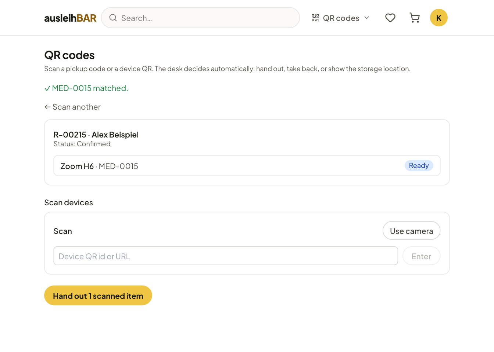

# Pickup, return and on-site use

Once your booking is **confirmed**, you pick up the items at the pool's
lending desk. Where it is and when it is open is stated in the confirmation
email and in [My bookings](my-bookings.md).

## Picking up

1. Come to the pool on the **first day** of your period during opening
   hours; for hourly bookings, at the booked start time.
2. At the desk, show the **pickup QR code** from the
   [confirmation email](emails.md#confirmation-email), for example on your
   phone, or give your **booking number** (e.g. R-00215).
3. The lending team scans your code and then the QR labels of the items it
   gives you.
4. As soon as the lending team has recorded the handout, it is on record.
   In My bookings the booking now appears under **Currently out** with the
   status **Picked up**.

This is what the lending team sees of your booking after scanning. If the
team has several identical items, it can also give you a different one
than the one held for you – nothing changes for you.

!!! tip "Someone else is picking up?"
    Write that in the message to the lending team when you submit, e.g.
    “picked up by Alex Beispiel”.

!!! note "Pickup missed"
    If you didn't pick up on the first day, the booking shows in My
    bookings as **Pickup missed**, and you usually get a reminder email.
    Contact the lending team in that case. If the whole period has passed
    without you picking up, Ausleihbar cancels the booking automatically.
    You don't automatically get a [strike](strikes.md) for it; whether the
    lending team issues one, for example for repeated no-shows, is at its
    discretion.

## Returning

1. Bring the items back to the pool's desk **by the end of your period**;
   for daily bookings, on the last booked day during opening hours at the
   latest.
2. The lending team takes the items back. For some products it has a
   checking note for this, such as which accessories belong to it, and
   checks whether everything is complete and in order.
3. Once everything is back, the booking appears under **Returned &
   cancelled** with the status **Returned**.

!!! warning "Something is broken?"
    Say so when you return it. The lending team then marks the item as
    defective so it gets repaired and nobody else receives a broken item.
    Other people's later bookings are moved to another item where possible;
    otherwise those affected get an email.

If you are late, the booking counts as **overdue**: it moves to the top in
My bookings, the start page shows a red notice, and you get
[reminders by email](emails.md#overdue-reminders).
Bring the items back as soon as possible or contact the lending team. A
clearly late return – just like an item returned damaged – is the typical
reason for a [strike](strikes.md); whether there is one is decided by the
lending team, not by Ausleihbar.

## On-site use

Some products aren't taken away but **used on site** during the booked
period, such as a podcast studio, a workspace or a 3D printer. The product
page then says **On-site use** under **Type of use**, and in your bookings
the item carries the label **On site**.

Booking works exactly like a loan, with calendar, cart and confirmation. A
cart may mix both. What happens afterwards depends on how the pool has set
up the product:

**With handout at the desk**
:   You check in at the lending desk at the start of your period. The
    lending team releases the item or room to you (status **In use**) and
    takes it back at the end (status **Used**).

**Without handout (self-service)**
:   The booking is just a reserved time slot. You simply come at the booked
    time and use the item; the desk isn't involved. After the end,
    Ausleihbar automatically closes the booking as **Used**. It can't
    become overdue. You can cancel it only until it starts.

!!! tip "Finished early?"
    For use without handout, [My bookings](my-bookings.md) shows the
    **End use** button next to the item once your period has started. It
    releases the rest of the period for others; this can't be undone. But
    you don't have to do anything: at the end of the period, Ausleihbar
    closes the use automatically as usual. If you forgot, the lending team
    can also end the use for you.

!!! info "How do I know which applies?"
    The explanation next to the status in My bookings tells you: “Check in
    at the lending desk when your time slot starts” means handout at the
    desk, “You can use the items on site during the booked time” means
    self-service.
