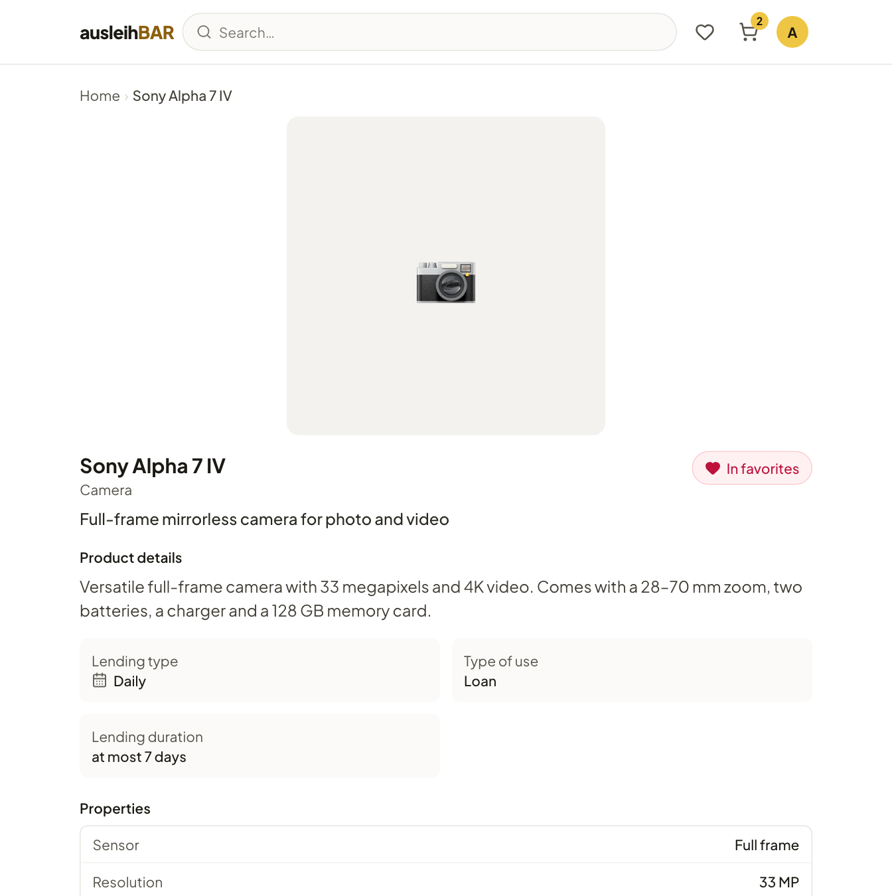
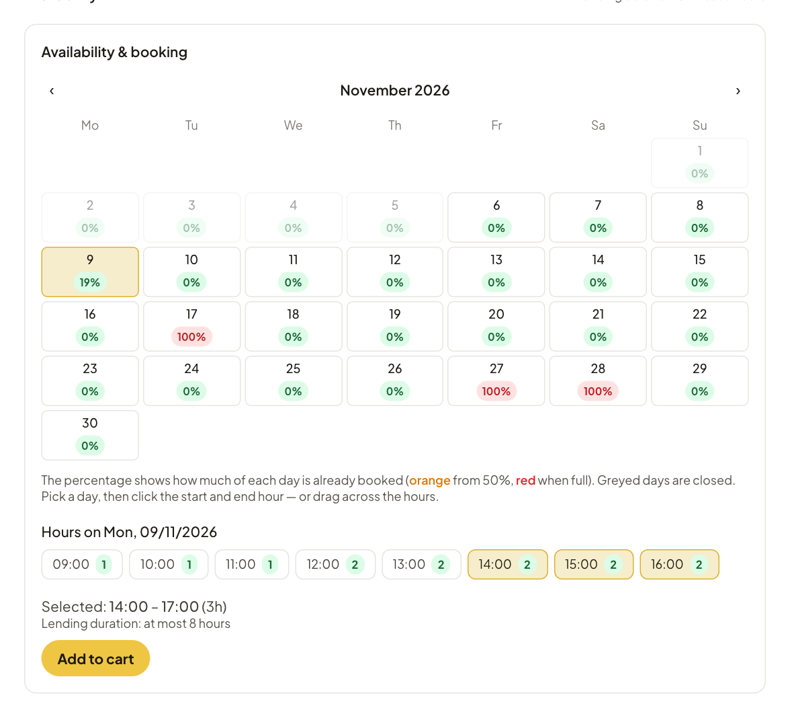

# Product page and availability

The product page has everything you need to know before booking, and below
it the calendar where you choose your period.

## What the product page shows

- **Images** – you can browse through several images and enlarge them.
- **Add to favorites** – saves the product to your [favorites](finding-items.md#favorites).
- **Product details** – the description, often with the accessories that
  come with it.
- **Lending type** – **Daily** or **Hourly**.
- **Type of use** – **Loan** (you take the item with you) or
  **On-site use** (you use it on the spot during the booked period,
  e.g. a room or a 3D printer; see
  [On-site use](pickup-and-return.md#on-site-use)).
- **Lending duration** – the shortest and longest permitted duration, if
  there is one.
- **Properties** – technical details such as sensor or resolution,
  depending on the product type, sometimes also a data sheet as a PDF.
- **Available at** – the pools that hold the product, with their address.
  If a pool requires a lead time, it says e.g. “book ≥24h in advance”.
- **Part of sets** – [sets](sets.md) that include the product.
- **Complementary items** – products the lending team recommends as a
  good addition, such as a tripod for a camera, each with the pools where
  they are available.

## Booking by the day

At the very bottom is the **Availability & booking** calendar.

1. The number in each day tells you how many units are free that day
   (green = free, red = none left).
2. Click your first day and then your last day. You can also drag from the
   start day to the end day. A single click books one day.
3. Below the calendar you see the selected period, e.g. “Selected:
   09/11/2026 → 11/11/2026”. **Clear selection** lets you start over.
4. If the product is in several pools, you then choose the **Pickup
   location**. Ausleihbar shows which pool still has something free in the
   chosen period and suggests a pool that is already in your cart.
5. Click **Add to cart**.

The first day is your pickup day, the last one your return day.

!!! note "Closed days"
    Days with a lock are **closed**: public holidays, block days or
    weekdays on which the pool doesn't open. Days beyond the booking horizon
    also appear this way. Closed days can be neither pickup nor return day,
    but a booking may span across them – for example from Friday to Monday
    over a closed weekend.

!!! tip "Lending duration"
    If the period is too short or too long, the calendar tells you what is
    allowed (“You can book at most 7 days at a time.”). The limits come
    from the product or the pool and can even differ per item. How far
    ahead you can book at most and whether there is a lead time is set by
    the pool.

## Booking by the hour

For hourly products, each day shows **what percentage** of the day is
already booked (orange from 50 %, red when fully booked).

1. Click a day. Below it, the hours of that day appear with the number of
   free units, as far as the pool is open.
2. Click the start hour and then the end hour, or drag across the hours.
3. Check the “Selected” line, e.g. “14:00 – 17:00 (3h)”.
4. Choose the **Pickup location** if needed and click **Add to cart**.

## After the click

The product is now in your cart, and an item is **held** for you. You can
keep browsing and add more, or continue straight away with **Go to cart** –
see [Cart and submitting a booking](cart.md).

!!! warning "Account blocked?"
    If your account is blocked, **Add to cart** stays grayed out. What that
    means is explained under [Strikes and blocks](strikes.md).
