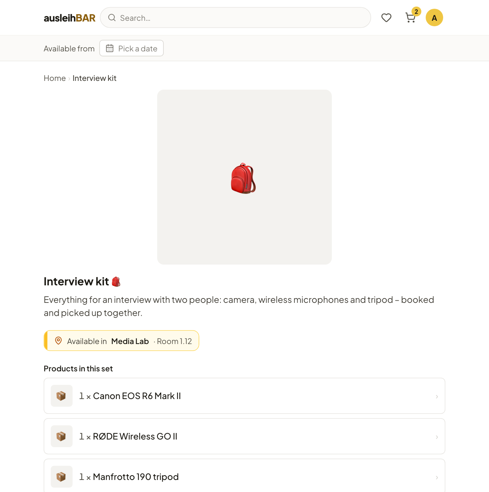

# Sets

A **set** bundles products that are often needed together, for example an
“Interview kit” made up of a camera, a wireless microphone and a tripod.
Instead of booking three products one by one, you choose a period once, and
everything lands in the cart together.

## Finding sets

Sets appear wherever products appear:

- in the categories under **Products and sets**,
- on the section tiles (e.g. “8 products · 1 set”),
- on every product page under **Part of sets**, if the product is included
  in a set.

You recognize a set by the backpack icon 🎒.

## Booking a set

1. Open the set page. **Products in this set** lists what belongs to it and
   in what quantity; a click on a product opens its page.
2. **Available in** names the pool the set comes from. A set always belongs
   to exactly one pool.
3. Choose your period in the calendar, just like on a
   [product page](product-page.md). The number per day tells you **how many
   complete sets** are free that day.
4. Click **Add to cart**.

Your cart then lists the individual products of the set. You can treat
them there like any other items.

!!! note "All or nothing"
    A set only goes into the cart if **all** of its products are free in
    the period. If one is missing, nothing is added and the message names
    the missing product. Then try a different period, or book the remaining
    products individually.

!!! tip "Lending duration in a set"
    A set takes the lending duration of its most limited product. The set
    page points this out when there is a limit.

If the set page says “This set can’t be booked right now”, the set isn't
assigned to a pool you have access to. In that case, ask the lending team.
