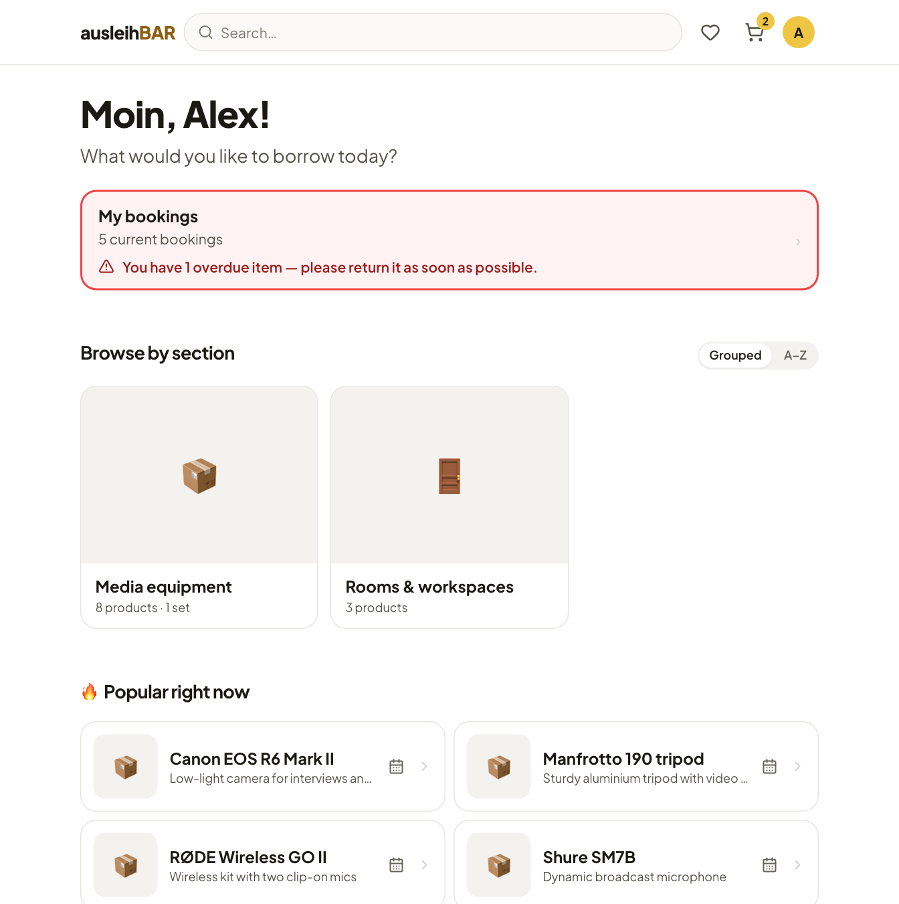
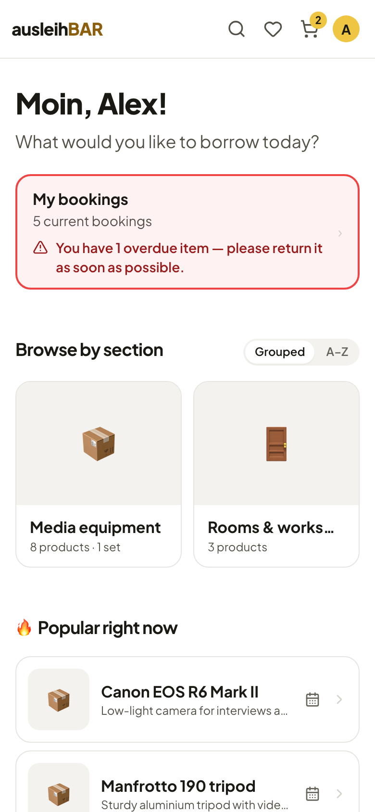
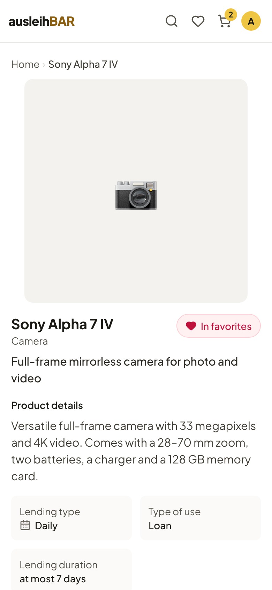

# Signing in and the start page

## Signing in

Ausleihbar uses your university's **single sign-on**. So you don't need a
separate account or a new password – you sign in with your usual university
account.

1. Open Ausleihbar in your browser, on a computer or on your smartphone.
2. Click **Sign in to start** (or **Sign in** at the top right).
3. You land on your university's sign-in page. Sign in there.
4. You are then taken back to Ausleihbar and see your start page.

The first time you sign in, Ausleihbar creates your account automatically –
with the name and email address from the sign-in. All
[emails about your bookings](emails.md) go to this address.

!!! note "What you see without signing in"
    Without signing in, Ausleihbar only shows a welcome page with a text from
    your institution and the lending locations (pools). If you click a pool,
    you sign in and go straight to that pool. The catalog, calendar and cart
    are only available after signing in. A link to a product, too, takes you
    exactly there after you sign in.

!!! info "Which sign-in exactly?"
    Your institution decides which sign-in service is behind it (Ausleihbar
    speaks OIDC, e.g. via Keycloak). If you have questions about your
    account, your university's computing center can help.

## The start page

After you sign in, Ausleihbar greets you with “Moin” and your name.
Below that you will find:

- **My bookings** – how many current bookings you have. If something is
  overdue or you missed a pickup, the card is red and tells you what to do.
  A click opens [My bookings](my-bookings.md).
- **Browse by section** – the main areas of the catalog, e.g. Media
  equipment. **Grouped | A–Z** switches between the sections and an
  alphabetical list of all products.
- **Popular right now**, **New arrivals** and **Your pools** – depending on
  your institution's settings, suggestions and the lending locations you can
  use appear here.

There is more about browsing and searching under [Finding items](finding-items.md).

## The header

The header is always there, even when you scroll:

- A click on **ausleihBAR** takes you to the start page.
- The **search field** searches the whole catalog.
- The **heart** opens your [favorites](finding-items.md#favorites).
- The **cart** shows with a number how many items are in it.
- Your **initial** opens the account menu.

When you browse the catalog, **Available from** also appears below the
header: if you pick a date there, the product cards show how many units are
free on that day.

## On your smartphone

Ausleihbar is made for smartphones. You don't need an app: your browser is
enough. On the small screen the search field becomes a magnifying glass;
everything else works just like on a computer.

## Language and appearance

In the **account menu** (your initial at the top right) you will find:

- **My bookings**,
- the interface **Language**, German or English – your choice also applies
  to the emails you get from Ausleihbar,
- the **Appearance**: Light, Dark or Auto (follows your system),
- **Sign out**.

At the very bottom of every page, the footer links to pages such as the
legal notice and the privacy policy, if your institution has created them.
