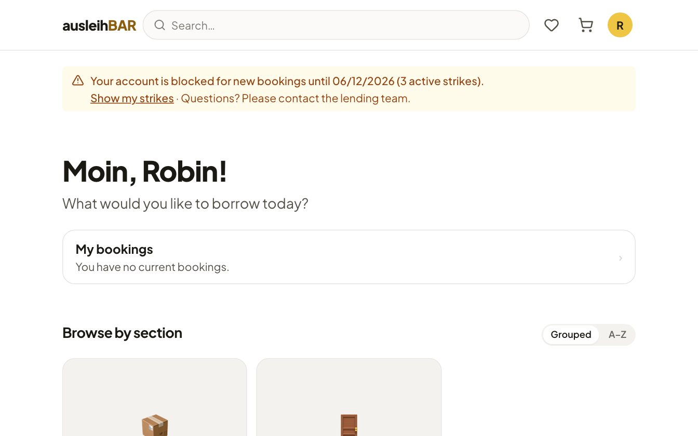

# Strikes and blocks

To keep items available for everyone, the lending team can issue
**strikes** when something goes wrong with a booking. Typical reasons are
a **clearly late return** or an item that comes back **damaged or dirty**;
a single missed pickup is usually no reason, but repeated no-shows can be
one. Anyone who collects too many strikes is blocked from new bookings for
a while.

!!! note "Never automatic"
    Ausleihbar **never issues strikes on its own** – neither for a missed
    pickup nor for an overdue return. Whether a strike is appropriate is
    always decided by a person on the lending team, who gives a reason. The
    only automatic step is the **block**, once the number of active strikes
    set by your institution is reached.

## What is a strike?

- A strike usually belongs to a **booking** and always has a **reason**
  given by the lending team.
- Strikes count **across all pools**, no matter which lending team issued
  them.
- Every strike **expires** after a fixed time set by your institution.
  Expired strikes no longer count.
- Only the administration can delete a strike.

If you get a strike, Ausleihbar sends you the email **“Strike for your
booking R-…”** with the reason, a personal message from the lending team if
there is one, the expiry date and the number of your active strikes. It
also tells you from how many strikes a block follows – or that your account
is now blocked.

In [My bookings](my-bookings.md), the booking concerned carries the notice
**Strike received** together with the reason.

## When is an account blocked?

Your institution sets levels, for example: from a certain number of active
strikes a block for a few days, with more strikes a longer or a permanent
block. If you reach a level, Ausleihbar blocks your account automatically
for the set time – that is the only automatic step; the strikes themselves
are always issued by the lending team.

## The notice on the page

If your account is blocked, a notice appears at the top of the start page,
on product and set pages, in your favorites, in the cart and in My
bookings, for example:
“Your account is blocked for new bookings until 06/12/2026 (3 active
strikes).”

While the block applies:

- you **can't add anything to the cart** – the **Add to cart** button stays
  greyed out,
- you **can't submit a booking**,
- you can still browse and look at your bookings.

With a time-limited block you can book again after the date given. With a
permanent block it says “Your account is blocked for new bookings
indefinitely …”.

## Viewing your strikes

Click **Show my strikes** in the notice. You land in My bookings in the
**Your strikes** section. For each strike it shows:

- the date,
- the reason,
- the booking and the pool,
- when it expires (“Expires on …”) – or **Expired** if it no longer
  counts.

!!! tip "Questions? Talk to the lending team"
    If you think a strike is wrong or there was a reason for the delay,
    contact the pool's lending team. The contact details are in the strike
    email and in your booking emails. The administration can delete a
    strike or lift a block.
