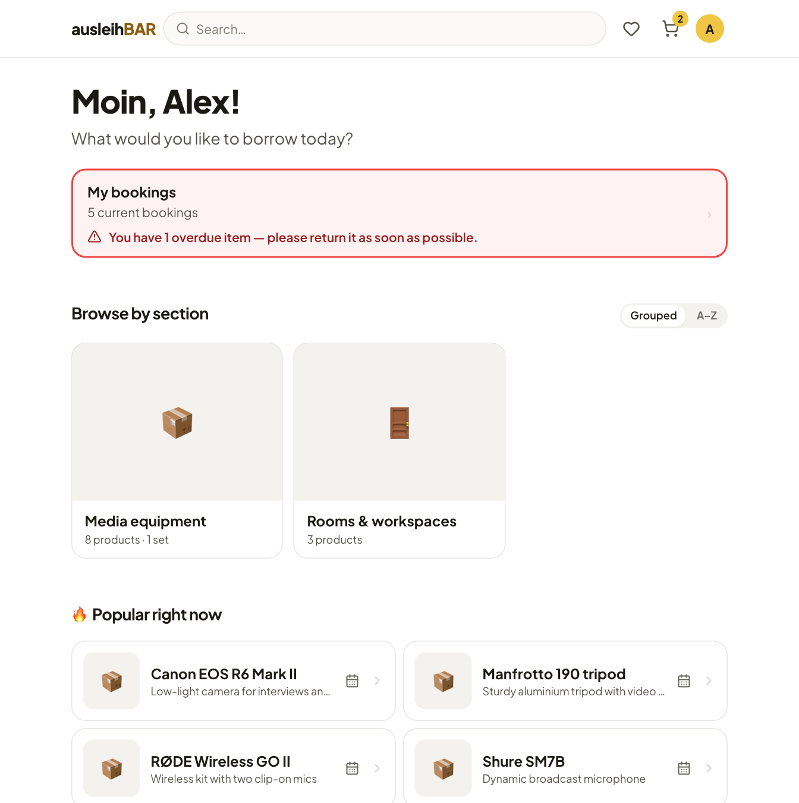
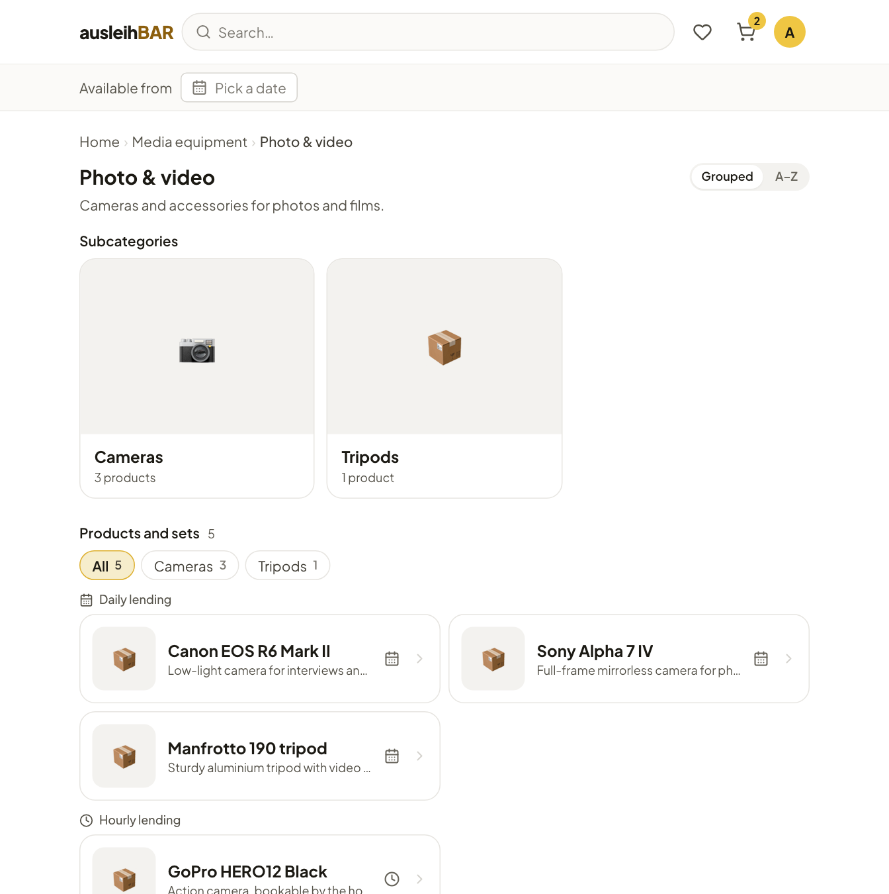
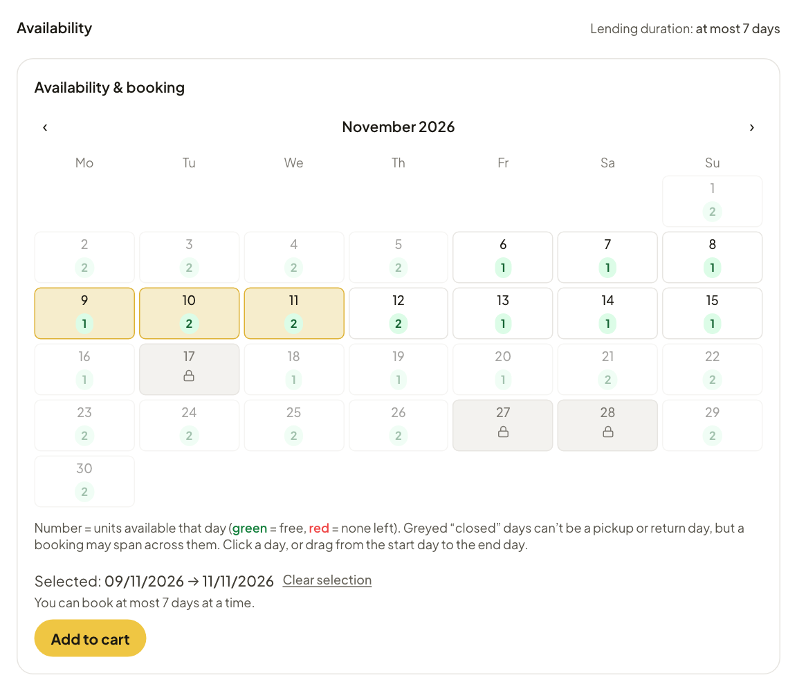
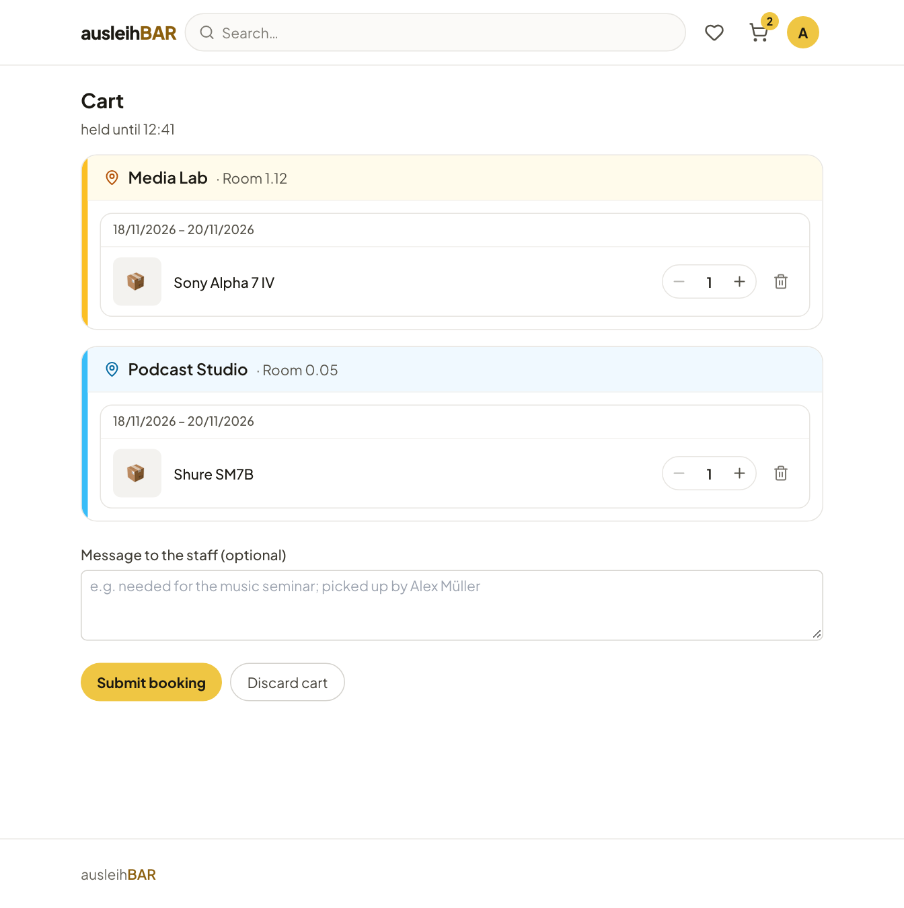
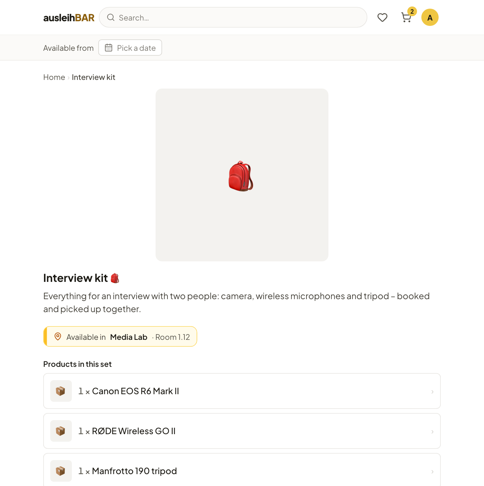
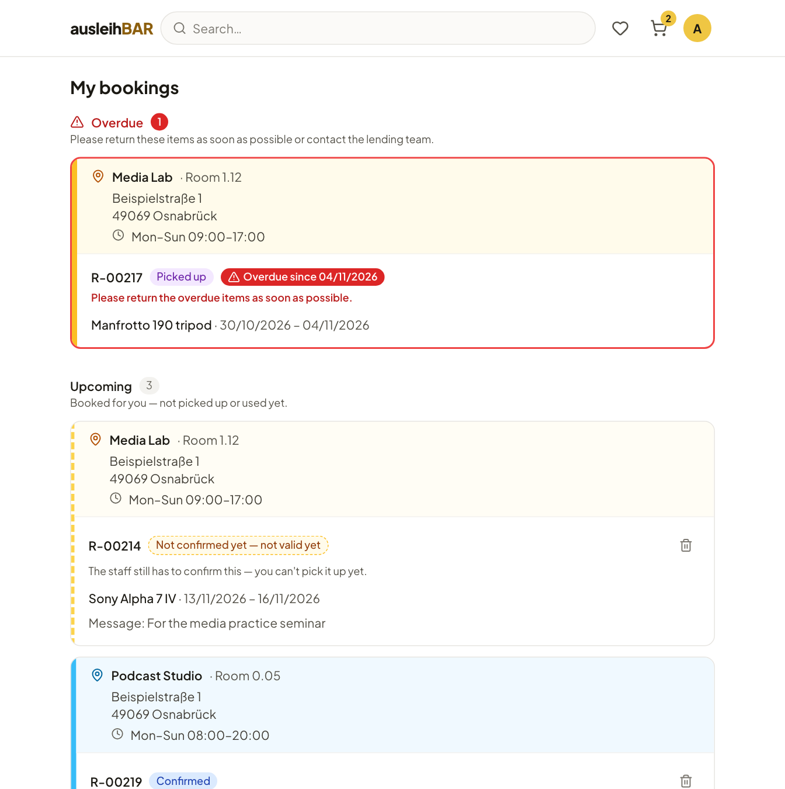
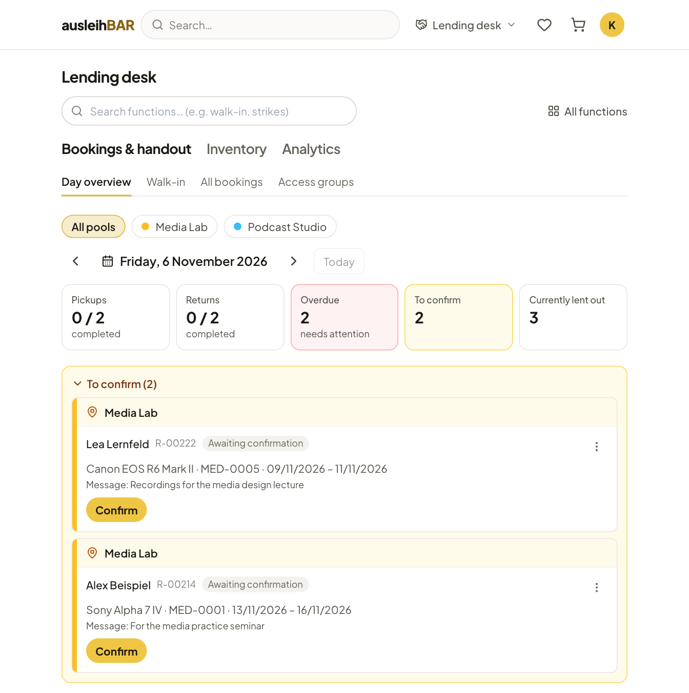
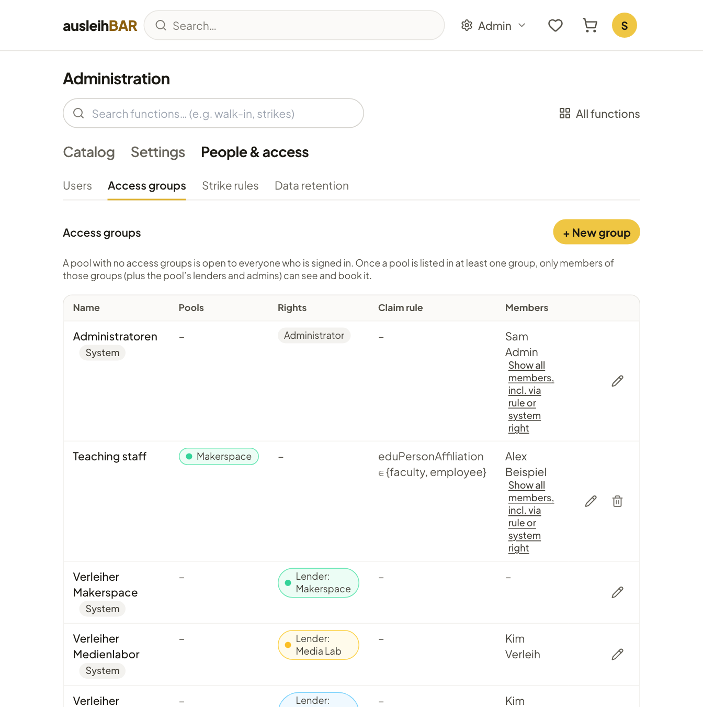
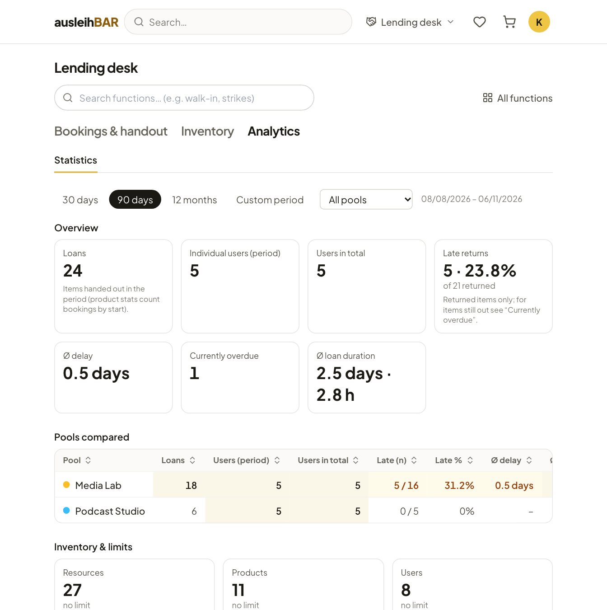

Open Source · virtUOS, Osnabrück University

<h1 class="al-hero__title">Your university's items, borrowed online with ease.</h1>

Ausleihbar works like an online shop for everything your university lends
out: look up a camera, microphone, laptop or podcast studio, see the free days
in the calendar, add it to your cart and submit. The lending team confirms
the booking, hands the items out at the lending desk and takes them back
again.

[Guide for borrowers](guide/index.md){ .md-button .md-button--primary }
[For lenders & admins](management/index.md){ .md-button }
[:fontawesome-brands-github: Source code on GitHub](https://github.com/virtUOS/ausleihbar){ .md-button }

<figure class="al-shot al-shot--hero" markdown>

</figure>

<ul class="al-facts">
  <li><strong>Single sign-on</strong>Sign in via OIDC with your university account</li>
  <li><strong>Open source</strong>Apache License 2.0, on GitHub</li>
  <li><strong>German &amp; English</strong>Interface, content and emails</li>
  <li><strong>Import from leihs</strong>Bring over your inventory from a leihs CSV export</li>
  <li><strong>Accessible</strong>Guided by WCAG 2.1 AA and BITV 2.0</li>
</ul>

## What Ausleihbar does { .al-section-title }

One tool for both sides of the desk: borrowers find and book on their own, while lending teams keep track of handouts, returns and inventory.

### Catalog and search

Sections, categories and subcategories lead you to the right item. Search
finds products, categories and sections; favorites remember what you need
often.

[:octicons-arrow-right-24: Finding items](guide/finding-items.md)

### Availability in the calendar

Daily products show the free units per day; hourly products show each day's
utilization and the free hours. Closed days and lending durations are already
taken into account.

[:octicons-arrow-right-24: Product page and availability](guide/product-page.md)

### One cart across several pools

Items from different lending locations go into one cart and are reserved
for you there. When you submit, one booking is created per pool, and each
lending team confirms its own.

[:octicons-arrow-right-24: Cart and submitting a booking](guide/cart.md)

### Sets

Things that are often needed together are ready as a set — say, a camera,
wireless microphone and tripod for an interview. One click books everything
together, or nothing at all if something is missing.

[:octicons-arrow-right-24: Sets](guide/sets.md)

### Loan or on-site use

Besides lending, there is on-site use, for example for a podcast studio or a
3D printer — with or without a handout at the desk. “My bookings” always
shows what's coming up, what you have and what's overdue.

[:octicons-arrow-right-24: Pickup, return and on-site use](guide/pickup-and-return.md)

### Lending desk

The day overview brings together pickups, returns, overdue items and new
bookings. Handout works by QR code: scan the pickup code from the email,
scan the items, done. Spontaneous loans happen right at the desk.

[:octicons-arrow-right-24: Day overview](management/day-overview.md) ·
[QR handout](management/handout.md) · [Walk-in lending](management/walk-in.md)

### Access groups and roles

Pools can be restricted to groups, even automatically based on details from
the sign-in. Who lends and who administers is also handled by groups: one
lending team per pool, plus the administrators.

[:octicons-arrow-right-24: People and access](management/people.md)

### Statistics

Loans, late returns, average loan duration and a comparison of pools over
any period you choose — with counts, never with names.

[:octicons-arrow-right-24: Statistics](management/statistics.md)

-   :material-cellphone: __Made for smartphones__

    Catalog, calendar and cart work just as well on your phone as on your
    computer — no app needed.

-   :material-email-outline: __Emails with calendar entry__

    A receipt email, a confirmation email with a pickup QR code and an `.ics`
    file, and a reminder the day before pickup. [More about the emails](guide/emails.md)

-   :material-calendar-lock-outline: __Block days and holidays__

    Public holidays and closing days are never pickup or return days. If a
    new block day is added, affected bookings are rebooked or canceled — with
    an email to the borrowers.

-   :material-alert-octagon-outline: __Strikes__

    If an item comes back significantly late or damaged, the lending team can
    issue a strike at its own discretion — never automatically. Once a set
    threshold is reached, the account is blocked from new bookings.
    [More about strikes](guide/strikes.md)

## Who it's for { .al-section-title }

-   :material-account-outline: __Borrowers__

    ---

    Students and staff who need something for a seminar, project or thesis:
    sign in, search, book, pick up.

    [:octicons-arrow-right-24: To the guide](guide/index.md)

-   :material-handshake-outline: __Lending teams__

    ---

    Media lab, library, makerspace: confirm bookings, hand out and take back
    items, maintain the inventory, track defects, print QR labels.

    [:octicons-arrow-right-24: For lenders & admins](management/index.md)

-   :material-server-network: __Universities and IT centers__

    ---

    Run it yourself with Docker Compose, sign in through your own identity
    provider (OIDC), import your existing inventory from leihs.

    [:octicons-arrow-right-24: To the installation](installation.md)

## Open source · run it yourself { .al-cta__title }

Ausleihbar is licensed under the Apache License 2.0 and runs as a Docker
Compose stack of PostgreSQL, Django and the React interface, served in
production behind Caddy with automatic HTTPS. The installation guide takes
you step by step to your own server. You'll find the source code on GitHub —
to review, run and contribute.

[To the installation guide](installation.md){ .md-button .md-button--primary }
[:fontawesome-brands-github: virtUOS/ausleihbar](https://github.com/virtUOS/ausleihbar){ .md-button }

