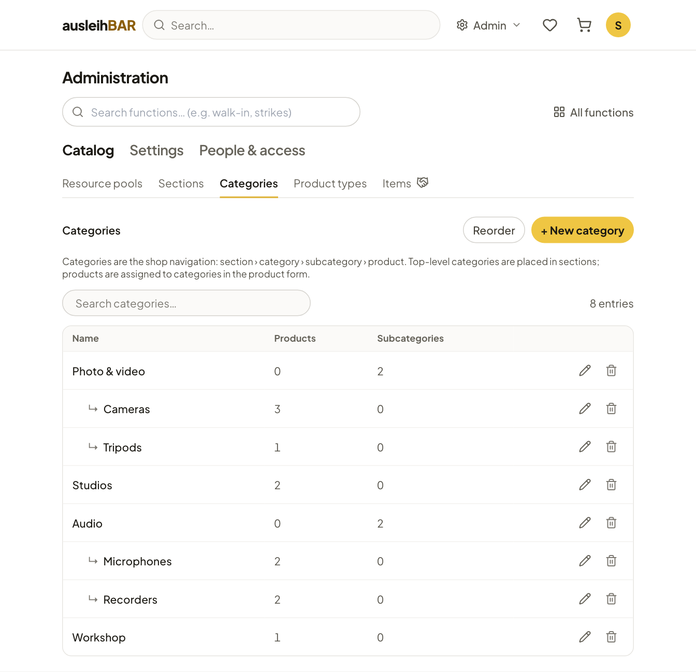

# Catalog: pools, sections, categories, product types

Under Administration → **Catalog** you set up *where* lending happens
(pools), *how* borrowers browse the catalog (sections and categories) and
*which details* a product has (product types). The products themselves are
maintained by the lending team ([Creating products](products.md)); the
**Items** menu entry takes you straight there in the lending desk.

This is how the shop fits together:

```text
Section  ›  Category  ›  Subcategory  ›  …  ›  Product  ›  Items (per pool)
```

## Pools

A pool is a lending location, such as a media lab or a workshop, with its
own lending team, its own opening hours and its own rules. In the menu the
page is called **Resource pools**. The list can be searched and sorted with
**Reorder**. The form has these sections:

**General**
:   Name, **Pool ID (short code)** — also the prefix of the inventory
    numbers, e.g. "MED" for MED-001 —, **Accent colour**, which marks the
    pool in lists and filters, an **Image** and **Active (bookable /
    shown)**.

**Location & contact**
:   Room, phone, email and address. They appear on the pool page and in
    the emails to borrowers.

**Description & directions**
:   Description and directions, e.g. how to find the room. The directions
    are also included in the pickup reminder.

**Opening hours**
:   The **Opening days** and, per day, the **Service times**, including
    several time spans per day. Pickup and return are only possible on
    opening days, hourly bookings only within the service times.

**Booking rules**
:   - **Lead time (hours before pickup):** how far ahead a booking must be
      made at the latest.
    - **Max booking horizon (months ahead):** how far in advance bookings
      can be made.
    - **Default lending duration:** min./max. days and min./max. hours for
      all items of the pool, unless the product or item sets its own
      ([Lending duration](products.md#lending-duration)). Empty = no
      limit.
    - **Require a message from the borrower when ordering from this
      pool:** the field "Message to the staff" becomes required on
      submission, and [walk-in lending](walk-in.md) also requires a note.

    Lead time and horizon don't apply to walk-in lending.

**Emails**
:   Whether the pool's contact address receives an email **when a device is
    marked defective** and **when a borrower cancels a booking**, plus an
    optional **Note in borrower emails**, which appears in this pool's
    section — e.g. "Please bring your student ID."

**Access**
:   - **Visibility:** With no group ticked, the pool is visible and
      bookable for everyone signed in. If you tick access groups, only
      their members see and book it — plus this pool's lenders and all
      admins. This also applies to its products and sets.
    - **Lenders:** Here you enter the lending team (search by name,
      username or email). These people are added to the group
      "Verleiher ‹Pool›". Further lenders can be authorized through other
      groups ([Access groups](people.md#access-groups)).

**Block days for this pool**
:   Days on which only this pool is closed, e.g. for a stocktaking
    ([Block days](settings.md#block-days-and-public-holidays)).


!!! warning "Deactivate a pool instead of deleting it"
    A pool that is temporarily not lending becomes invisible and
    unbookable when you untick **Active**. Deleted pools go to the
    [trash](settings.md#trash).

## Sections

Sections are the top level of the lending area, e.g. "Media equipment" or
"Rooms & workspaces"; borrowers see them on the start page. A section has a
**Title**, a **Description** and an **Image**. You assign to it:

- **Categories** — top-level categories only; their subcategories come
  along automatically. You set the order below.
- **Sets** — they are shown in the section after the categories, also in
  their own order.

A category can be in several sections. You change the order of the
sections with **Reorder**.

## Categories

Categories form the navigation: section › category › subcategory ›
product, at any depth. The list shows the tree with the number of products
and subcategories.



In a category's form:

- **Name** and **Description**, an **Image**.
- **Parent category** — empty for a top-level category.
- **Sections** — top-level categories only. If you move a category under
  another one, it is removed from its sections.
- **Order of the products** assigned directly to the category.

Which products are in a category is set by the lending team in the
[product form](products.md#placement-in-the-shop). **Reorder** only moves
categories within the same parent category.

## Product types

A product type is the template for a product's details, e.g. "Camera" with
sensor, resolution and lens mount. Every product has exactly one type. The
list shows the number of properties and products for each type; **Clone
type** creates a copy as a starting point.


Each **property** has:

- a **Key** (internal, e.g. `sensor`) and a **Label** in German and
  English,
- a **Type**: short text, long text, date, time, number, URL or media
  (image, PDF document),
- an optional **Default**,
- **Filled in: On the product** (one value for all units, e.g. the
  sensor) or **On the device** (per unit, e.g. "last maintenance"),
- **Visible to borrowers** — whether the property appears on the product
  page,
- **Required**.

Properties on the device are never visible in the shop and can only be
text, date, time, number or URL. Date properties on the device can be
filtered on the Items page, for example by due maintenance
([Filtering](items.md#filtering)).

!!! tip "Switching from ‘On the product’ to ‘On the device’"
    If you switch an existing property from product to device, the
    products' values become the starting values of their items. The other
    way round, the items' values are no longer used and the product value
    starts out empty.
    If you remove a property that has already been filled in, Ausleihbar
    asks first.

!!! info "Suggest properties with AI — only if set up"
    If an AI service is connected in your installation, **Suggest
    properties with AI** proposes suitable properties based on the type's
    label and description, optionally with your own hints to the AI.
