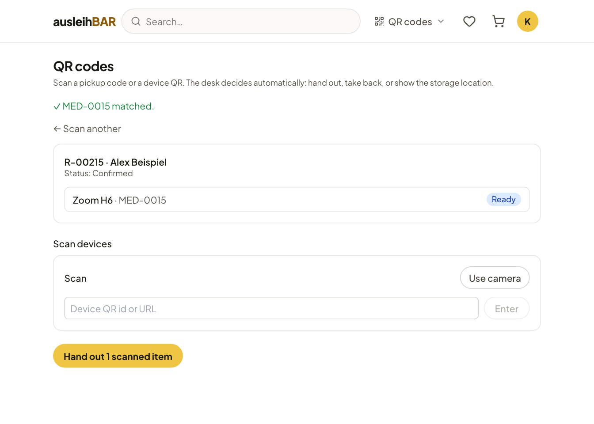

# Handout, return and QR codes

You can hand out and take back items in two ways: with a click in the
[Day overview](day-overview.md) or in [All bookings](bookings.md), or by
scanning on the **QR codes** page. Both lead to the same result; scanning
also checks that you really have the right items in your hand.

## Handing out with a button

In the **Pickups** and **⚠ Overdue** sections, every period of a confirmed
booking has a **Hand out** button.

1. Look up the booking, e.g. by the name or the booking number (R-…) the
   person gives you.
2. Hand over the listed items — the inventory number follows the product,
   e.g. "Zoom H6 · MED-0015".
3. Click **Hand out**. All items of this period that are still open now
   count as handed out; the booking has the status **Picked up**.

In the booking's **⋮** menu you find **Give a strike** and, as long as
nothing has been handed out, **Cancel booking**. The smaller **⋮** menu on a
single item offers **Mark defective** or **Mark repaired**.

!!! tip "Better to scan"
    For bookings with several items, or when several identical items sit on
    the shelf, the [QR page](#the-qr-page) is safer: it notices when you
    grab a different item than the reserved one, and then records the right
    one.

## Taking back

In **Returns due** and **⚠ Overdue**, handed-out items have a **Return**
button.

- Without a check note, the return is recorded immediately.
- If at least one product has **Return information** (see
  [Creating products](products.md#for-lenders)), the **Check the return**
  dialog opens. It shows the note for each item, for example which
  accessories belong to it. For each item, choose **All good** or **Report
  defect** (with a short description, "What's wrong?") and finish with
  **Complete return**. **Cancel** aborts the whole return; nothing is
  recorded.

Once everything is back, the booking has the status **Returned**.

## Reporting defects

You can mark an item as defective at the return, via the **⋮** menu on the
item, on the QR page or on the [Items](items.md) page. Then the following
happens:

- The item has the status **Defective** and is no longer lent out.
- Ausleihbar moves later bookings of this item to a free identical item in
  the same pool. If there is none, the affected person receives an email,
  and you see a notice saying how many bookings could not be moved.
- If this is set up in the pool, the pool's contact address receives an
  email and — if GitLab is connected — an issue is created
  ([Defects and GitLab](items.md#defects)).

Once the item is fixed, choose **Mark repaired**.

## The QR page

The **QR codes** page (area menu at the top right) is made for work at the
desk. Scan with the camera of your tablet or phone (**Use camera**) or with
a handheld scanner, or type in the code. It understands two kinds of codes:

- the **pickup QR code** from the person's confirmation email, or their
  booking number (R-…),
- an item's **QR label** ([QR labels](items.md#qr-labels)).

Depending on what you scan, the page decides by itself what to do:

| You scan … | The page … |
| --- | --- |
| a pickup code | loads the booking for handout ("Loaded R-… for ….") |
| an item that is currently lent out | opens the return of its booking |
| an item whose confirmed pickup has already started | loads that booking for handout |
| any other item | shows its **Storage location** and lets you mark it as defective or available |

### Handing out by scan

1. Scan the person's pickup code.
2. Under **Scan devices**, scan the labels of the items you hand over, one
   after the other. Each matching item is confirmed with "✓ … matched." and
   marked as **Ready**.
3. Click **Hand out … scanned item**.

If you scan something that doesn't match exactly, the page asks:

- **Same product, different item:** "Scanned … — booked unit is …". With
  **Swap unit**, the scanned item is entered into the booking.
- **Item doesn't belong to the booking:** With **Add as extra** it is added
  to the booking, e.g. a spare battery the person takes along on the spot.

Items for on-site use without handout are listed for information only; if
you scan one, the page reports that it needs no handout.

### Taking back by scan

Scan the label of an item that is lent out; the page opens the return of
its booking. Select the items coming back by tapping or scanning and click
**Take back … item**. Items with return information are marked "check on
return"; for them the **Check the return** dialog opens as above. This way
you can also take back just part of a booking.

!!! info "Codes for borrowers"
    If someone without lending rights scans an item label with their phone,
    they land on the product page in the lending area. The pickup QR code
    and the calendar entry only come as attachments of the
    [confirmation email](../guide/emails.md#confirmation-email); the
    booking page in the lending area shows no QR code.

What the handout looks like from the borrower's side is described in
[Pickup, return and on-site use](../guide/pickup-and-return.md).
