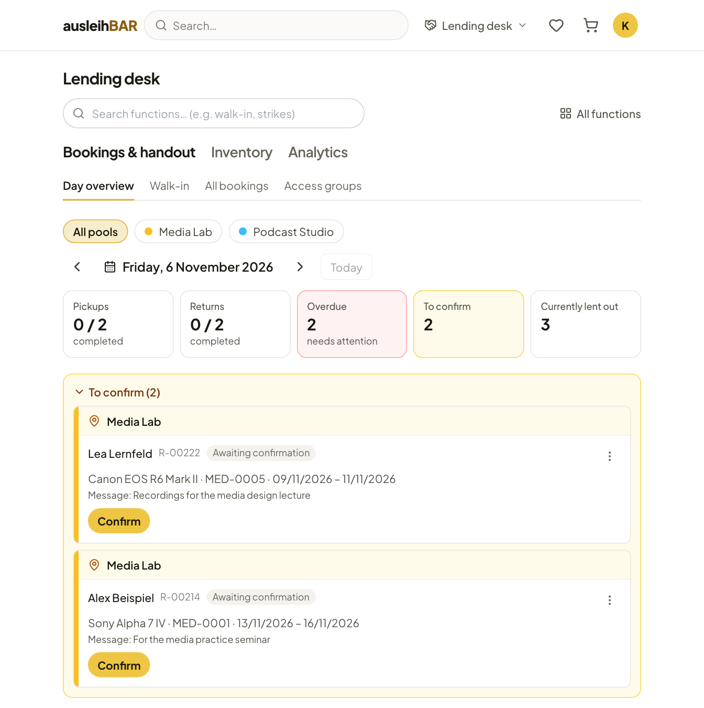

# For lenders and admins

This part adds the other side of the desk to the
[guide for borrowers](../guide/index.md). What borrowers see — catalog,
calendar, cart, My bookings, emails — is covered there. Here you learn how a
lending team confirms bookings, hands out and takes back items and maintains
the inventory, and how the administration sets up pools, catalog, settings
and access rights.

## Who may do what

Ausleihbar knows three roles. Everyone who signs in is a **borrower**. The
other two roles are granted by the administration, usually through
[access groups](people.md#access-groups):

**Borrower**
:   May browse and book in the lending area — in all open pools and in the
    pools unlocked for one of their access groups.

**Lender**
:   Belongs to the lending team of one or more pools and works at the
    **lending desk**: confirming bookings, handing out, taking back, issuing
    strikes, maintaining items. Products and sets belong to the shared
    catalog and can be edited by all lenders.

**Admin**
:   Has access to all pools and also to the **administration**: pools,
    sections, categories, product types, settings, people and access.

More on this in [Roles and areas](roles.md).

## Two areas

-   :material-handshake-outline: **Lending desk** — for lenders

    The lending team's workplace, organized into **Bookings &
    handout**, **Inventory** and **Analytics**. Plus the **QR codes** page
    for scanning at the desk.

-   :material-cog-outline: **Administration** — for admins

    Setting up Ausleihbar, organized into **Catalog**,
    **Settings** and **People & access**.

You switch between the areas and the lending area using the menu at the top
right of the header. How to find your way around both areas, including the
**function search** and **All functions**, is described in
[Roles and areas](roles.md#finding-functions).

## Chapters

### Lending desk

-   :material-account-key-outline: **[Roles and areas](roles.md)**

    Roles, area menu, "My pools | All pools", function search.

-   :material-calendar-today: **[Day overview](day-overview.md)**

    To confirm, pickups, returns, overdue items, on-site uses.

-   :material-qrcode-scan: **[Handout, return and QR codes](handout.md)**

    Handing out, checking returns, reporting defects, the QR page.

-   :material-account-arrow-right-outline: **[Walk-in lending](walk-in.md)**

    Lend spontaneously at the desk or book for later.

-   :material-format-list-bulleted: **[All bookings and strikes](bookings.md)**

    Search and cancel bookings, issue strikes, view profiles.

-   :material-account-multiple-outline: **[Access groups](access-groups.md)**

    Who may see and book your pools' items.

-   :material-package-variant-closed: **[Items, defects and QR labels](items.md)**

    Inventory, status, properties, defects, GitLab, printing labels.

-   :material-file-document-edit-outline: **[Creating products](products.md)**

    Product type, lending type, on-site use, durations, images, categories.

-   :material-bag-personal-outline: **[Sets](sets.md)**

    Products that are lent together.

-   :material-chart-bar: **[Statistics](statistics.md)**

    Loans, late returns, pools compared, demand, defects.

### Administration

-   :material-map-marker-outline: **[Catalog: pools, sections, categories, product types](catalog.md)**

    Lending locations, shop navigation and properties.

-   :material-tune: **[Settings](settings.md)**

    Block days, cart, mail texts, pages, import/export, trash.

-   :material-account-group-outline: **[People and access](people.md)**

    Users, access groups, strike rules, data retention.

!!! info "Some things depend on your installation"
    Some functions only exist if they were set up during
    [installation](../installation.md): the **AI support** (e.g. "Fill from
    PDF (AI)"), **machine translation** of texts between German and English
    and **limits** on items, products or users. Each lending team sets up
    the **GitLab issues** for defects itself for its pool. This guide notes
    each of these where it applies.
