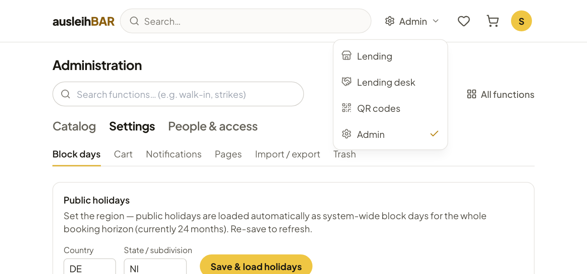

# Roles and areas

Which areas you see depends on your role. The role belongs to your account
and is granted by the administration — usually through access groups, which
can also be filled automatically from the details of your sign-in.

## The three roles

| Role | Who | What |
| --- | --- | --- |
| **Borrower** | everyone who is signed in | browse, book, manage their own bookings |
| **Lender** | members of the group "Verleiher ‹Pool›" or of a group that grants lending rights for a pool | the lending desk for these pools |
| **Admin** | accounts with admin rights or manual members of a group with admin rights, e.g. "Administratoren" | all pools and the administration |

A few rules worth knowing:

- **Lending rights apply per pool.** Someone who only looks after the media
  lab sees only its bookings and items at the desk. In the lists this then
  reads e.g. "Lender · 2" for someone with two pools.
- **Products and sets are a shared catalog.** All lenders can create and
  edit products and sets; items, on the other hand, always belong to a pool.
- **Admins always have access to all pools**, including pools that are only
  visible to certain groups.
- Lenders and admins are borrowers too: they can book for themselves in the
  lending area just like everyone else.

How the administration grants roles is described in
[People and access](people.md).

## Switching between areas

At the top right of the header, Ausleihbar shows which area you are in. A
click opens the **Switch area** menu:

- **Lending** — the shop as all borrowers see it,
- **Lending desk** — the lending team's workplace,
- **QR codes** — the scan page for handout and return
  ([more on this](handout.md#the-qr-page)),
- **Admin** — the administration, for admins only.

## The menus

Both areas have a two-level menu: at the top you choose a menu group, below
it the page.

**Lending desk**

| Menu group | Pages |
| --- | --- |
| **Bookings & handout** | [Day overview](day-overview.md), [Walk-in](walk-in.md), [All bookings](bookings.md), [Access groups](access-groups.md) |
| **Inventory** | [Items](items.md), [Defects](items.md#defects), [Sets](sets.md), [QR labels](items.md#qr-labels) |
| **Analytics** | [Statistics](statistics.md) |

**Administration**

| Menu group | Pages |
| --- | --- |
| **Catalog** | [Resource pools](catalog.md#pools), [Sections](catalog.md#sections), [Categories](catalog.md#categories), [Product types](catalog.md#product-types), Items (opens the lending desk) |
| **Settings** | [Block days](settings.md#block-days-and-public-holidays), [Cart](settings.md#cart), [Notifications](settings.md#notifications), [Pages](settings.md#pages), [Import / export](settings.md#import-and-export), [Trash](settings.md#trash) |
| **People & access** | [Users](people.md#users), [Access groups](people.md#access-groups), [Strike rules](people.md#strike-rules), [Data retention](people.md#data-retention) |

## My pools | All pools

If you are an admin **and** also registered as a lender for individual
pools, the lending desk initially shows you only **your** pools. The switch
**My pools (n) | All pools** then appears above the function search. With
**All pools** you see the lists and counters of all pools, for example to
help another lending team.

!!! note "Only a view, not a right"
    The switch only filters the lending desk's lists. It does not change
    your rights as an admin: booking details, QR scans and walk-in lending
    work for all pools. While you are filling in a walk-in loan, the switch
    is locked — complete or clear it first.

Pure lenders don't see the switch; for them there are only their pools.

## Finding functions

At the very top of the lending desk and the administration is the search
**Search functions… (e.g. walk-in, strikes)**. Type a keyword, such as
"holidays", "labels" or "defective", and jump straight to the right page.
Besides the names, the search also knows common other words, e.g.
"inventory" for the items.

Next to it, **All functions** opens an overview of all management pages you
have access to, each with a sentence on what it does.

!!! tip "Where am I?"
    In "All functions", lenders see only the lending desk; admins also see
    the administration. If a page you need is missing, you probably lack
    the right for it — contact the administration.
