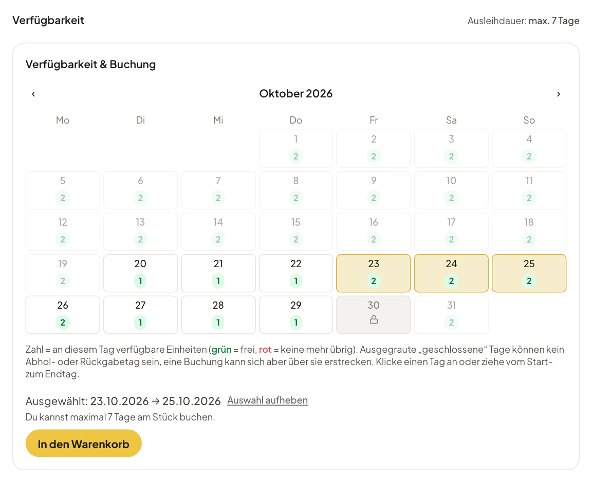
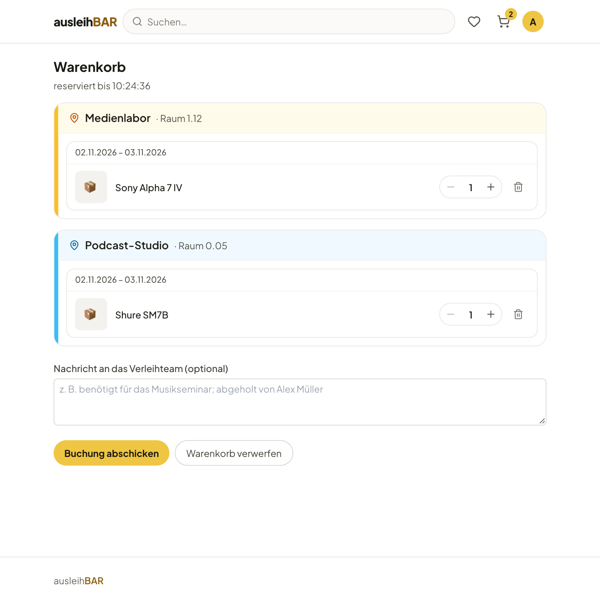
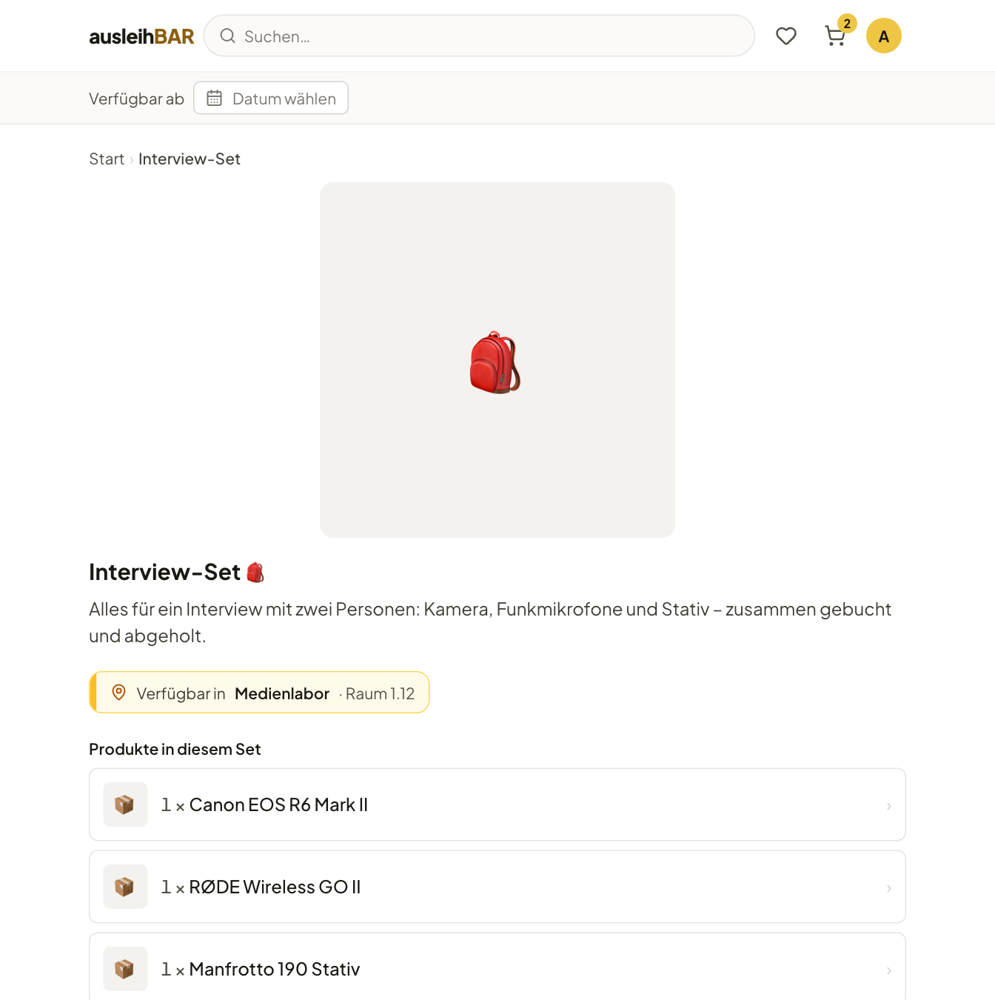
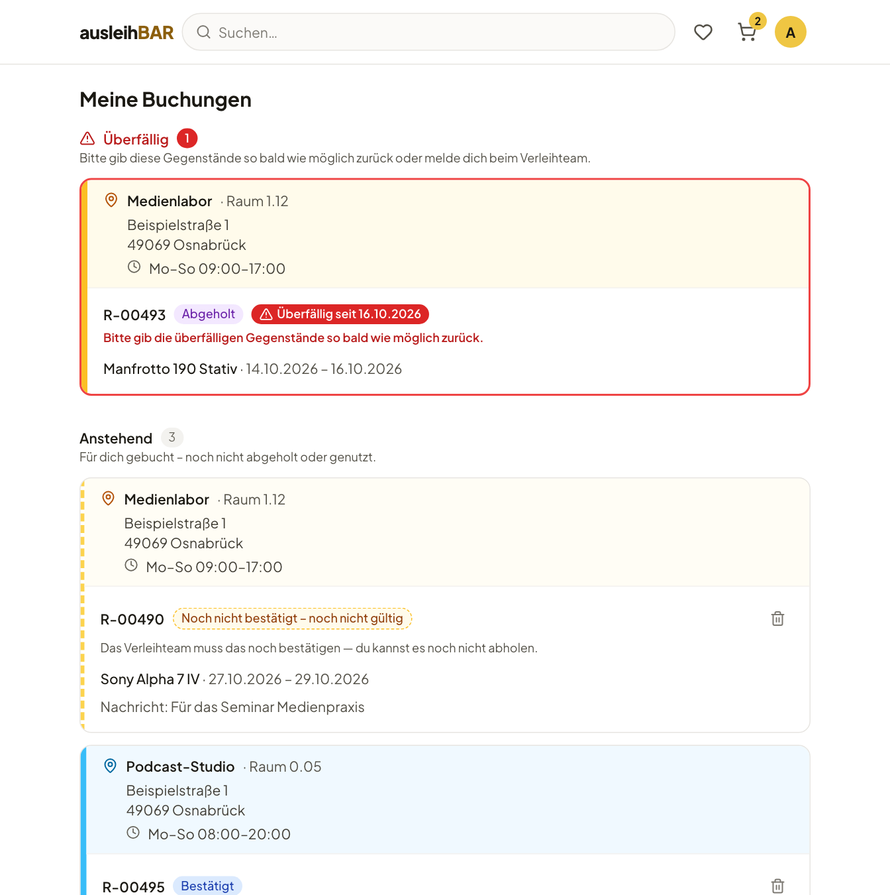
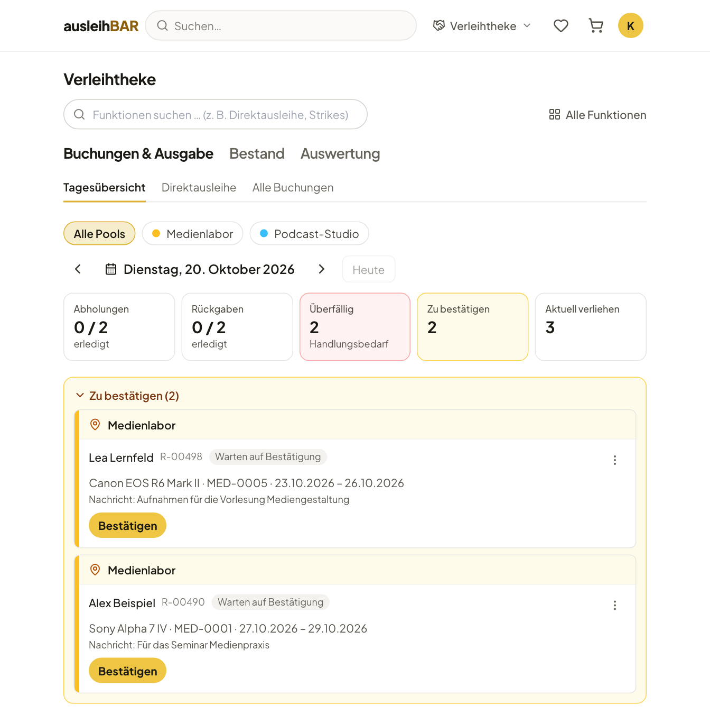
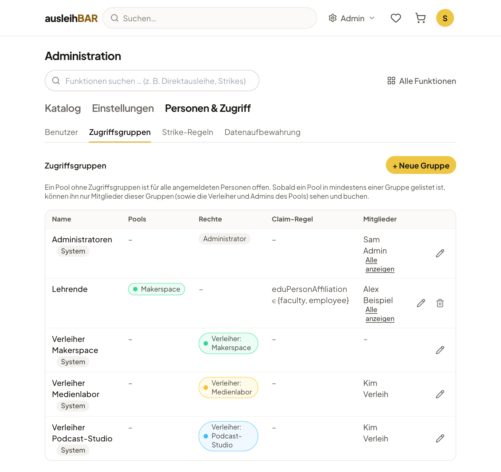
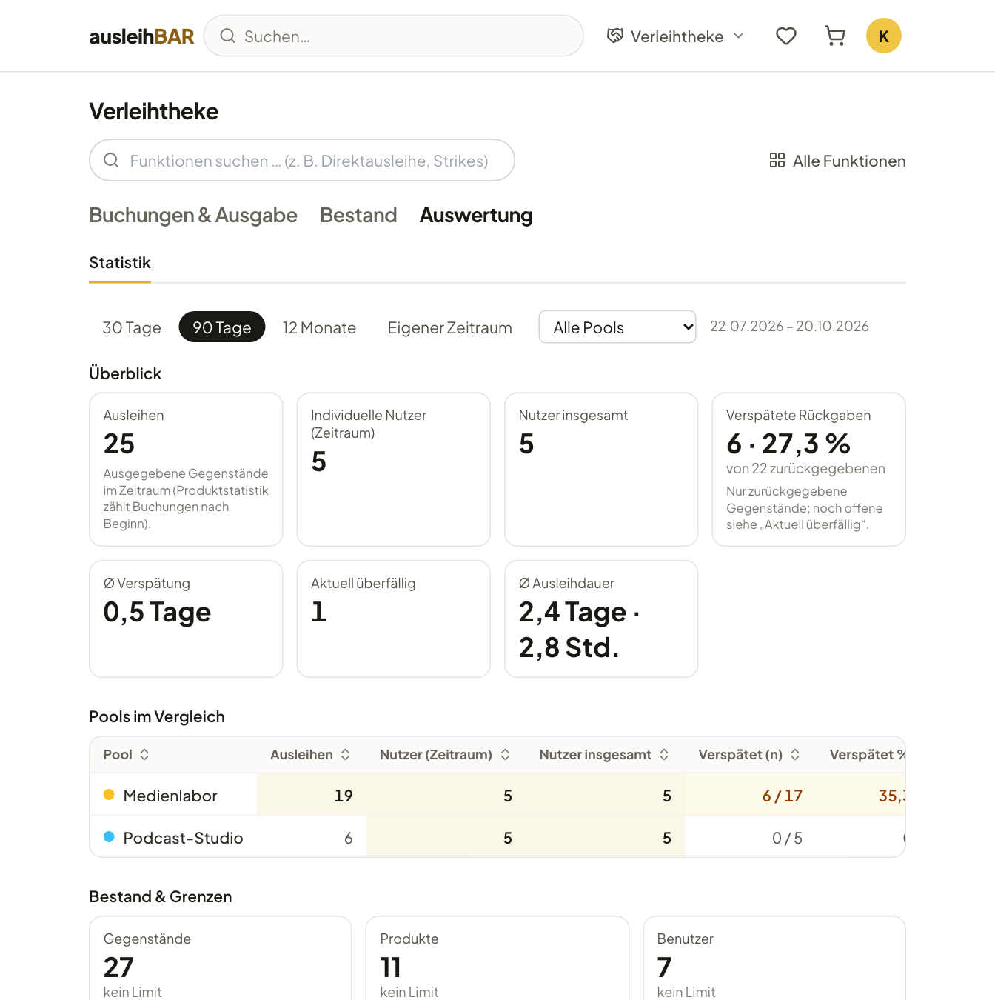

Open Source · virtUOS, Universität Osnabrück

<h1 class="al-hero__title">Gegenstände der Hochschule einfach online ausleihen.</h1>

Ausleihbar funktioniert wie ein Onlineshop für alles, was eure Hochschule
verleiht: Kamera, Mikrofon, Laptop oder Podcast-Studio suchen, freie Tage im
Kalender sehen, in den Warenkorb legen und abschicken. Das Verleihteam
bestätigt die Buchung, gibt die Gegenstände an der Verleihtheke aus und nimmt
sie wieder zurück.

[Anleitung für Ausleihende](anleitung/index.md){ .md-button .md-button--primary }
[Für Verleihende & Admins](verwaltung/index.md){ .md-button }
[:fontawesome-brands-github: Quellcode auf GitHub](https://github.com/virtUOS/ausleihbar){ .md-button }

<figure class="al-shot al-shot--hero" markdown>

</figure>

<ul class="al-facts">
  <li><strong>Single Sign-on</strong>Anmeldung per OIDC mit der Hochschulkennung</li>
  <li><strong>Open Source</strong>Apache-Lizenz 2.0, auf GitHub</li>
  <li><strong>Deutsch &amp; Englisch</strong>Oberfläche, Inhalte und E-Mails</li>
  <li><strong>Import aus leihs</strong>Bestand aus einem leihs-CSV-Export übernehmen</li>
  <li><strong>Barrierearm</strong>orientiert an WCAG 2.1 AA und BITV 2.0</li>
</ul>

## Was Ausleihbar kann { .al-section-title }

Ein Werkzeug für beide Seiten der Theke: Ausleihende finden und buchen selbst, Verleihteams behalten den Überblick über Ausgaben, Rückgaben und den Bestand.

### Katalog und Suche

Sparten, Kategorien und Unterkategorien führen zum passenden Gegenstand. Die
Suche findet Produkte, Kategorien und Sparten; Favoriten merken sich, was du
öfter brauchst.

[:octicons-arrow-right-24: Gegenstände finden](anleitung/finden.md)

### Verfügbarkeit im Kalender

Tageweise Produkte zeigen freie Einheiten pro Tag, stundenweise Produkte die
Auslastung pro Tag und freie Stunden. Geschlossene Tage und
Ausleihdauern sind gleich eingerechnet.

[:octicons-arrow-right-24: Produktseite und Verfügbarkeit](anleitung/produkt.md)

### Warenkorb über mehrere Pools

Gegenstände aus verschiedenen Ausleihstellen landen in einem Warenkorb und
sind dort für dich reserviert. Beim Absenden entsteht je Pool eine Buchung,
die jedes Verleihteam für sich bestätigt.

[:octicons-arrow-right-24: Warenkorb und Buchung absenden](anleitung/warenkorb.md)

### Sets

Was oft zusammen gebraucht wird, liegt als Set bereit — etwa Kamera,
Funkmikrofon und Stativ für ein Interview. Ein Klick bucht alles gemeinsam,
oder gar nichts, wenn etwas fehlt.

[:octicons-arrow-right-24: Sets](anleitung/sets.md)

### Ausleihe oder Nutzung vor Ort

Neben der Ausleihe gibt es die Nutzung vor Ort, etwa für ein Podcast-Studio
oder einen 3D-Drucker — mit oder ohne Ausgabe an der Theke. „Meine
Buchungen“ zeigt jederzeit, was ansteht, was du hast und was überfällig ist.

[:octicons-arrow-right-24: Abholung, Rückgabe und Nutzung vor Ort](anleitung/abholung.md)

### Verleihtheke

Die Tagesübersicht bündelt Abholungen, Rückgaben, Überfälliges und neue
Buchungen. Ausgegeben wird per QR-Code: Abhol-Code aus der Mail scannen,
Gegenstände scannen, fertig. Spontane Ausleihen gehen direkt an der Theke.

[:octicons-arrow-right-24: Tagesübersicht](verwaltung/tagesuebersicht.md) ·
[QR-Ausgabe](verwaltung/ausgabe.md) · [Direktausleihe](verwaltung/direktausleihe.md)

### Zugriffsgruppen und Rollen

Pools lassen sich auf Gruppen beschränken, auch automatisch über Angaben aus
der Anmeldung. Wer verleiht und wer administriert, regeln ebenfalls Gruppen:
je Pool ein Verleihteam, dazu die Administration.

[:octicons-arrow-right-24: Personen und Zugriff](verwaltung/personen.md)

### Statistik

Ausleihen, verspätete Rückgaben, durchschnittliche Ausleihdauer und der
Vergleich der Pools über einen frei wählbaren Zeitraum — mit Anzahlen,
nie mit Namen.

[:octicons-arrow-right-24: Statistik](verwaltung/statistik.md)

-   :material-cellphone: __Fürs Smartphone gemacht__

    Katalog, Kalender und Warenkorb funktionieren auf dem Handy genauso gut
    wie am Rechner — ganz ohne App.

-   :material-email-outline: __E-Mails mit Kalendereintrag__

    Eingangs- und Bestätigungsmail mit Abhol-QR-Code und `.ics`-Datei, eine
    Erinnerung am Tag vor der Abholung. [Mehr zu den Mails](anleitung/mails.md)

-   :material-calendar-lock-outline: __Sperrtage und Feiertage__

    Feiertage und Schließtage sind keine Abhol- oder Rückgabetage. Kommt
    ein Sperrtag dazu, werden betroffene Buchungen umgebucht oder storniert
    — mit E-Mail an die Ausleihenden.

-   :material-alert-octagon-outline: __Strikes__

    Läuft bei einer Buchung etwas schief, etwa eine verpasste Abholung, kann
    das Verleihteam einen Strike vergeben; ab einer Schwelle wird das Konto
    für neue Buchungen gesperrt.
    [Mehr zu Strikes](anleitung/strikes.md)

## Für wen { .al-section-title }

-   :material-account-outline: __Ausleihende__

    ---

    Studierende und Beschäftigte, die etwas für Seminar, Projekt oder
    Abschlussarbeit brauchen: anmelden, suchen, buchen, abholen.

    [:octicons-arrow-right-24: Zur Anleitung](anleitung/index.md)

-   :material-handshake-outline: __Verleihteams__

    ---

    Medienlabor, Bibliothek, Makerspace: Buchungen bestätigen, ausgeben und
    zurücknehmen, Bestand pflegen, Defekte verfolgen, QR-Etiketten drucken.

    [:octicons-arrow-right-24: Für Verleihende & Admins](verwaltung/index.md)

-   :material-server-network: __Hochschulen und Rechenzentren__

    ---

    Selbst betreiben mit Docker Compose, Anmeldung über den eigenen Identity
    Provider (OIDC), bestehenden Bestand aus leihs importieren.

    [:octicons-arrow-right-24: Zur Installation](installation.md)

## Open Source · selbst betreiben { .al-cta__title }

Ausleihbar steht unter der Apache-Lizenz 2.0 und läuft als
Docker-Compose-Stack aus PostgreSQL, Django und der React-Oberfläche, im
Betrieb hinter Caddy mit automatischem HTTPS. Die Installationsanleitung
führt Schritt für Schritt bis zum eigenen Server. Den Quellcode findest du
auf GitHub — zum Prüfen, Betreiben und Mitentwickeln.

[Zur Installationsanleitung](installation.md){ .md-button .md-button--primary }
[:fontawesome-brands-github: virtUOS/ausleihbar](https://github.com/virtUOS/ausleihbar){ .md-button }

