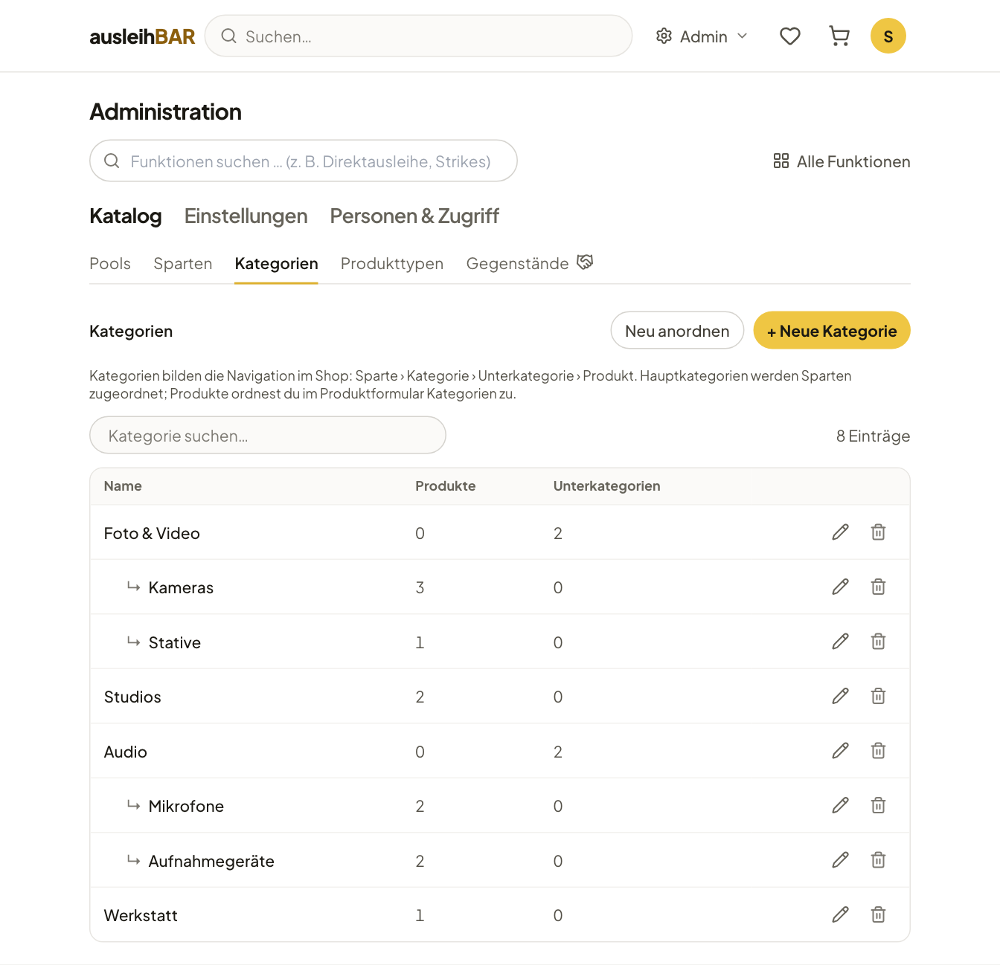

# Katalog: Pools, Sparten, Kategorien, Produkttypen

Unter Administration → **Katalog** richtest du ein, *wo* verliehen wird
(Pools), *wie* Ausleihende den Katalog durchstöbern (Sparten und
Kategorien) und *welche Angaben* ein Produkt hat (Produkttypen). Die
Produkte selbst pflegt das Verleihteam ([Produkte anlegen](produkte.md));
der Menüpunkt **Gegenstände** führt direkt dorthin in die Verleihtheke.

So hängt der Shop zusammen:

```text
Sparte  ›  Kategorie  ›  Unterkategorie  ›  …  ›  Produkt  ›  Gegenstände (je Pool)
```

## Pools

Ein Pool ist eine Ausleihstelle, etwa ein Medienlabor oder eine Werkstatt,
mit eigenem Verleihteam, eigenen Öffnungszeiten und eigenen Regeln. Die Liste
lässt sich durchsuchen und mit **Neu anordnen** sortieren. Das Formular hat diese Abschnitte:

**Allgemein**
:   Name, **Pool-ID (Kurzcode)** — zugleich das Präfix der
    Bestandsnummern, z. B. „MED“ für MED-0001 —, **Akzentfarbe**, mit der
    der Pool in Listen und Filtern markiert ist, ein **Bild** und **Aktiv
    (buchbar / sichtbar)**.

**Standort & Kontakt**
:   Raum, Telefon, E-Mail und Adresse. Sie stehen auf der Pool-Seite und in
    den Mails an Ausleihende.

**Beschreibung & Anfahrt**
:   Beschreibung und Wegbeschreibung, z. B. wie man den Raum findet. Die
    Wegbeschreibung kommt auch in die Abholerinnerung.

**Öffnungszeiten**
:   Die **Öffnungstage** und je Tag die **Servicezeiten**, auch mehrere
    Zeitspannen pro Tag. Abholung und Rückgabe sind nur an Öffnungstagen
    möglich, stundenweise Buchungen nur innerhalb der Servicezeiten.

**Buchungsregeln**
:   - **Vorlaufzeit (Stunden vor Abholung):** so lange vorher muss
      spätestens gebucht werden.
    - **Maximaler Buchungshorizont (Monate im Voraus):** wie weit im Voraus
      gebucht werden kann.
    - **Standard-Ausleihdauer:** Min./Max. Tage und Min./Max. Stunden für
      alle Gegenstände des Pools, sofern Produkt oder Gegenstand nichts
      Eigenes festlegen ([Ausleihdauer](produkte.md#ausleihdauer)). Leer =
      keine Begrenzung.
    - **Nachricht der ausleihenden Person verlangen:** Das Feld „Nachricht
      an das Verleihteam“ wird beim Absenden zur Pflicht, und auch die
      [Direktausleihe](direktausleihe.md) verlangt eine Notiz.

    Vorlaufzeit und Horizont gelten nicht für die Direktausleihe.

**E-Mails**
:   Ob die Kontaktadresse des Pools eine Mail bekommt, **wenn ein
    Gegenstand als defekt markiert wird** und **wenn eine ausleihende
    Person eine Buchung storniert**, dazu ein optionaler **Hinweis in
    Bucher-Mails**, der im Abschnitt dieses Pools steht — z. B. „Bitte
    Studierendenausweis mitbringen.“

**Zugriff**
:   - **Sichtbarkeit:** Ohne angehakte Gruppe ist der Pool für alle
      Angemeldeten sichtbar und buchbar. Hakst du Zugriffsgruppen an,
      sehen und buchen ihn nur deren Mitglieder — plus die Verleiher
      dieses Pools und alle Admins. Das gilt auch für seine Produkte und
      Sets.
    - **Verleiher:** Hier trägst du das Verleihteam ein (Suche nach Name,
      Benutzername oder E-Mail). Die Personen landen in der Gruppe
      „Verleiher ‹Pool›“. Weitere Verleiher können über andere Gruppen
      berechtigt sein ([Zugriffsgruppen](personen.md#zugriffsgruppen)).

**Sperrtage für diesen Pool**
:   Tage, an denen nur dieser Pool geschlossen ist, z. B. wegen einer
    Inventur ([Sperrtage](einstellungen.md#sperrtage-und-feiertage)).


!!! warning "Pool deaktivieren statt löschen"
    Ein Pool, der vorübergehend nicht verleiht, wird mit **Aktiv** abgehakt
    unsichtbar und unbuchbar. Gelöschte Pools landen im
    [Papierkorb](einstellungen.md#papierkorb).

## Sparten

Sparten sind die oberste Ebene im Verleih, z. B. „Medientechnik“ oder „Räume
& Arbeitsplätze“; Ausleihende sehen sie auf der Startseite. Eine Sparte hat
einen **Titel**, eine **Beschreibung** und ein **Bild**. Ihr ordnest du zu:

- **Kategorien** — nur Hauptkategorien; ihre Unterkategorien kommen
  automatisch mit. Die Reihenfolge stellst du darunter ein.
- **Sets** — sie werden in der Sparte nach den Kategorien angezeigt, ebenfalls
  in eigener Reihenfolge.

Eine Kategorie kann in mehreren Sparten stehen. Die Reihenfolge der Sparten
änderst du mit **Neu anordnen**.

## Kategorien

Kategorien bilden die Navigation: Sparte › Kategorie › Unterkategorie ›
Produkt, in beliebiger Tiefe. Die Liste zeigt den Baum mit der Zahl der
Produkte und Unterkategorien.



Im Formular einer Kategorie:

- **Name** und **Beschreibung**, ein **Bild**.
- **Übergeordnete Kategorie** — leer für eine Hauptkategorie.
- **Sparten** — nur bei Hauptkategorien. Verschiebst du eine Kategorie unter
  eine andere, wird sie aus ihren Sparten entfernt.
- **Reihenfolge der Produkte**, die der Kategorie direkt zugeordnet sind.

Welche Produkte in einer Kategorie stehen, legt das Verleihteam im
[Produktformular](produkte.md#einordnung-im-shop) fest. **Neu anordnen**
verschiebt Kategorien nur innerhalb derselben übergeordneten Kategorie.

## Produkttypen

Ein Produkttyp ist die Vorlage für die Angaben eines Produkts, z. B.
„Kamera“ mit Sensor, Auflösung und Objektivanschluss. Jedes Produkt hat
genau einen Typ. Die Liste zeigt je Typ die Zahl der Eigenschaften und
Produkte; **Typ klonen** legt eine Kopie als Ausgangspunkt an.


Jede **Eigenschaft** hat:

- einen **Schlüssel** (intern, z. B. `sensor`) und eine **Bezeichnung** auf
  Deutsch und Englisch,
- einen **Typ**: Kurztext, Langtext, Datum, Uhrzeit, Zahl, URL oder Medien
  (Bild, PDF-Dokument),
- einen optionalen **Standardwert**,
- **Ausgefüllt: Am Produkt** (ein Wert für alle Exemplare, z. B. der
  Sensor) oder **Am Gegenstand** (je Exemplar, z. B. „letzte Wartung“),
- **Für Entleiher sichtbar** — ob die Eigenschaft auf der Produktseite
  erscheint,
- **Pflichtfeld**.

Eigenschaften am Gegenstand sind nie im Shop sichtbar und können nur Text,
Datum, Uhrzeit, Zahl oder URL sein. Datums-Eigenschaften am Gegenstand
lassen sich auf der Seite Gegenstände filtern, etwa nach fälliger Wartung
([Filtern](gegenstaende.md#filtern)).

!!! tip "Von „Am Produkt“ zu „Am Gegenstand“ wechseln"
    Stellst du eine bestehende Eigenschaft von Produkt auf Gegenstand um,
    werden die Werte der Produkte zu Startwerten ihrer Gegenstände. Umgekehrt
    gehen die Werte der Gegenstände verloren, der Produktwert beginnt leer.
    Entfernst du eine Eigenschaft, die schon ausgefüllt ist, fragt
    Ausleihbar vorher nach.

!!! info "Eigenschaften mit KI vorschlagen — nur, wenn eingerichtet"
    Ist bei deiner Installation ein KI-Dienst angebunden, schlägt
    **Eigenschaften mit KI vorschlagen** anhand von Bezeichnung und
    Beschreibung des Typs passende Eigenschaften vor; optional mit eigenen
    Hinweisen an die KI.
