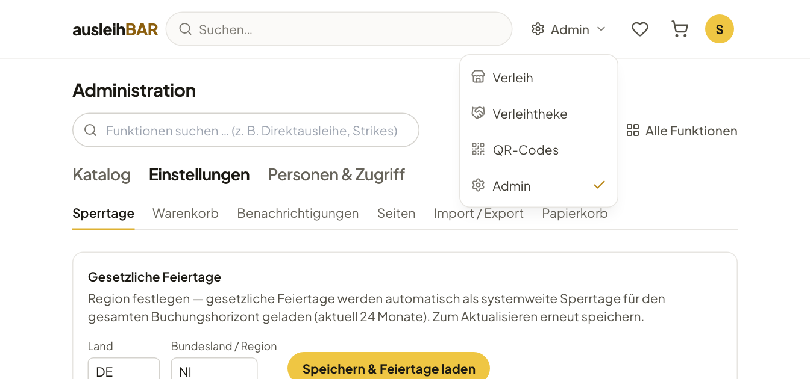

# Rollen und Bereiche

Welche Bereiche du siehst, hängt von deiner Rolle ab. Die Rolle hängt an
deinem Konto und wird von der Administration vergeben – meist über
Zugriffsgruppen, die auch automatisch aus den Angaben deiner Anmeldung
entstehen können.

## Die drei Rollen

| Rolle | Wer | Was |
| --- | --- | --- |
| **Entleiher** | jede angemeldete Person | stöbern, buchen, eigene Buchungen verwalten |
| **Verleiher** | Mitglieder der Gruppe „Verleiher ‹Pool›“ oder einer Gruppe, die für einen Pool Verleihrechte gibt | die Verleihtheke für diese Pools |
| **Admin** | Konten mit Admin-Recht oder manuelle Mitglieder einer Gruppe mit Admin-Recht, z. B. „Administratoren“ | alle Pools und die Administration |

Ein paar Regeln, die man kennen sollte:

- **Verleihrechte gelten je Pool.** Wer nur das Medienlabor betreut, sieht
  an der Theke nur dessen Buchungen und Gegenstände. In den Listen heißt es
  dann z. B. „Verleiher · 2“ für jemanden mit zwei Pools.
- **Produkte und Sets sind gemeinsamer Katalog.** Alle Verleihenden können
  Produkte und Sets anlegen und bearbeiten; Gegenstände gehören dagegen
  immer zu einem Pool.
- **Admins haben immer Zugriff auf alle Pools**, auch auf Pools, die nur für
  bestimmte Gruppen sichtbar sind.
- Verleihende und Admins sind zugleich Entleiher: Sie können im Verleih
  ganz normal für sich selbst buchen.

Wie die Administration Rollen vergibt, steht in
[Personen und Zugriff](personen.md).

## Zwischen den Bereichen wechseln

Oben rechts in der Kopfzeile zeigt Ausleihbar, in welchem Bereich du gerade
bist. Ein Klick öffnet das Menü **Bereich wechseln**:

- **Verleih** – der Shop, so wie ihn alle Ausleihenden sehen,
- **Verleihtheke** – der Arbeitsplatz des Verleihteams,
- **QR-Codes** – die Scan-Seite für Ausgabe und Rücknahme
  ([mehr dazu](ausgabe.md#die-qr-seite)),
- **Admin** – die Administration, nur für Admins.

## Die Menüs

Beide Bereiche haben ein zweistufiges Menü: Oben wählst du ein Gebiet, darunter
die Seite.

**Verleihtheke**

| Gebiet | Seiten |
| --- | --- |
| **Buchungen & Ausgabe** | [Tagesübersicht](tagesuebersicht.md), [Direktausleihe](direktausleihe.md), [Alle Buchungen](buchungen.md), [Zugriffsgruppen](zugriffsgruppen.md) |
| **Bestand** | [Gegenstände](gegenstaende.md), [Defekte](gegenstaende.md#defekte), [Sets](sets.md), [QR-Etiketten](gegenstaende.md#qr-etiketten) |
| **Auswertung** | [Statistik](statistik.md) |

**Administration**

| Gebiet | Seiten |
| --- | --- |
| **Katalog** | [Pools](katalog.md#pools), [Sparten](katalog.md#sparten), [Kategorien](katalog.md#kategorien), [Produkttypen](katalog.md#produkttypen), Gegenstände (öffnet die Verleihtheke) |
| **Einstellungen** | [Sperrtage](einstellungen.md#sperrtage-und-feiertage), [Warenkorb](einstellungen.md#warenkorb), [Benachrichtigungen](einstellungen.md#benachrichtigungen), [Seiten](einstellungen.md#seiten), [Import / Export](einstellungen.md#import-und-export), [Papierkorb](einstellungen.md#papierkorb) |
| **Personen & Zugriff** | [Benutzer](personen.md#benutzer), [Zugriffsgruppen](personen.md#zugriffsgruppen), [Strike-Regeln](personen.md#strike-regeln), [Datenaufbewahrung](personen.md#datenaufbewahrung) |

## Meine Pools | Alle Pools

Bist du Admin **und** zugleich als Verleiher für einzelne Pools eingetragen,
zeigt dir die Verleihtheke zunächst nur **deine** Pools. Über der
Funktionssuche erscheint dann der Schalter **Meine Pools (n) | Alle Pools**.
Mit **Alle Pools** siehst du die Listen und Zähler aller Pools, etwa um
einem anderen Verleihteam zu helfen.

!!! note "Nur eine Ansicht, kein Recht"
    Der Schalter filtert nur die Listen der Verleihtheke. Deine Rechte als
    Admin ändert er nicht: Buchungsdetails, QR-Scans und die Direktausleihe
    funktionieren für alle Pools. Während du eine Direktausleihe ausfüllst,
    ist der Schalter gesperrt – schließe sie erst ab oder leere sie.

Reine Verleihende sehen den Schalter nicht; für sie gibt es nur ihre Pools.

## Funktionen finden

Ganz oben in der Verleihtheke und der Administration steht die Suche
**Funktionen suchen … (z. B. Direktausleihe, Strikes)**. Tippe ein Stichwort,
etwa „Feiertage“, „Etiketten“ oder „kaputt“, und spring direkt zur passenden
Seite. Die Suche kennt neben den Namen auch gängige andere Wörter, z. B.
„Inventar“ für die Gegenstände.

Daneben öffnet **Alle Funktionen** eine Übersicht aller Verwaltungsseiten,
auf die du Zugriff hast, jeweils mit einem Satz dazu, was sie tut.

!!! tip "Wo bin ich?"
    Verleihende sehen in „Alle Funktionen“ nur die Verleihtheke, Admins
    zusätzlich die Administration. Fehlt dir eine Seite, die du brauchst,
    fehlt dir vermutlich das Recht dazu – wende dich an die Administration.
